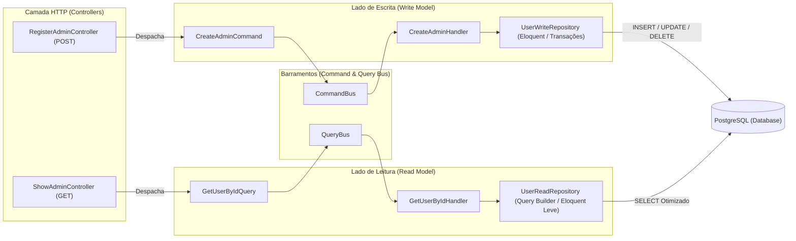

# Análise Arquitetural do Projeto e Implementação de CQRS no Laravel 12

Este documento apresenta uma **análise técnica detalhada** do estado atual do repositório `homee.laravel` e demonstra como evoluir a arquitetura atual (baseada em Clean Architecture com Actions + DTOs + Repositories) para o padrão **CQRS (Command Query Responsibility Segregation)**.

---

## 1. Análise do Estado Atual do Projeto

### 1.1. Stack e Infraestrutura
- **Framework**: Laravel 12 (`^12.0`) com PHP `^8.2` (rodando em container Sail PHP 8.5 + PostgreSQL 18 Alpine via [`compose.yaml`](file:///Users/hugolcouto/Projetos/homee/homee.laravel/compose.yaml)).
- **Roteamento API**: Habilitado em [`bootstrap/app.php`](file:///Users/hugolcouto/Projetos/homee/homee.laravel/bootstrap/app.php#L8-L13) apontando para [`routes/api.php`](file:///Users/hugolcouto/Projetos/homee/homee.laravel/routes/api.php), já com suporte a Sanctum migrado (`personal_access_tokens`).
- **Injeção de Dependência**: Configurada no [`AppServiceProvider`](file:///Users/hugolcouto/Projetos/homee/homee.laravel/app/Providers/AppServiceProvider.php#L14-L18), fazendo o bind de [`UserRepositoryInterface`](file:///Users/hugolcouto/Projetos/homee/homee.laravel/app/Domain/Users/Repositories/UserRepositoryInterface.php) para [`UserRepository`](file:///Users/hugolcouto/Projetos/homee/homee.laravel/app/Infrastructure/Persistence/Eloquent/UserRepository.php).

### 1.2. Pontos Fortes já Implementados
1. **Separação em Camadas (`Domain`, `Application`, `Infrastructure`, `Http`)**:
   - Os Single Action Controllers ([`RegisterAdminController`](file:///Users/hugolcouto/Projetos/homee/homee.laravel/app/Http/Controllers/Api/V1/Admin/RegisterAdminController.php) e [`ShowAdminController`](file:///Users/hugolcouto/Projetos/homee/homee.laravel/app/Http/Controllers/Api/V1/Admin/ShowAdminController.php)) estão enxutos e delegam toda a lógica.
2. **Tipagem Forte e Segurança**:
   - Uso de `readonly class` e `#[SensitiveParameter]` no [`CreateAdminDTO`](file:///Users/hugolcouto/Projetos/homee/homee.laravel/app/Domain/Users/DTOs/CreateAdminDTO.php).
   - Uso de Backed Enum no [`UserRoleEnum`](file:///Users/hugolcouto/Projetos/homee/homee.laravel/app/Domain/Users/Enums/UserRoleEnum.php) integrado ao cast do Model [`User`](file:///Users/hugolcouto/Projetos/homee/homee.laravel/app/Models/User.php#L45-L52).
3. **Prontidão Natural para CQRS**:
   - Você já separou as operações em classes distintas:
     - Escrita: [`CreateAdminUserAction`](file:///Users/hugolcouto/Projetos/homee/homee.laravel/app/Application/Users/Actions/CreateAdminUserAction.php)
     - Leitura: [`GetUserByIdAction`](file:///Users/hugolcouto/Projetos/homee/homee.laravel/app/Application/Users/Actions/GetUserByIdAction.php)

### 1.3. Pontos de Atenção no Código Atual (Code Review)
1. **Migration [`0001_01_01_000000_create_users_table.php`](file:///Users/hugolcouto/Projetos/homee/homee.laravel/database/migrations/0001_01_01_000000_create_users_table.php#L19)**:
   - Na linha 19, está sendo utilizado `->after("email")` dentro de `Schema::create('users', ...)`. O modificador `->after()` só funciona em `Schema::table()` (ALTER TABLE) no MySQL/MariaDB e é ignorado no PostgreSQL/SQLite. Em `Schema::create()`, a ordem física das linhas no código já define a ordem das colunas.
2. **Acoplamento de Leitura e Escrita no mesmo Repositório ([`UserRepositoryInterface`](file:///Users/hugolcouto/Projetos/homee/homee.laravel/app/Domain/Users/Repositories/UserRepositoryInterface.php))**:
   - Atualmente, `UserRepositoryInterface` concentra tanto métodos de mutação (`createAdmin`) quanto métodos de consulta (`findById`). À medida que o sistema de imóveis crescer (filtros geográficos, faixas de preço de aluguel/venda, dashboards), esse repositório único se tornará uma classe gigante (*God Class*) e obrigará consultas de leitura a carregar Models Eloquent pesados.
3. **Falta de Tipagem de Retorno em [`GetUserByIdAction::execute`](file:///Users/hugolcouto/Projetos/homee/homee.laravel/app/Application/Users/Actions/GetUserByIdAction.php#L18)**:
   - O método `execute(int $id)` pode declarar explicitamente `: User` como tipo de retorno.

---

## 2. O que é CQRS e Por Que faz Sentido em um Sistema Imobiliário?

**CQRS (Command Query Responsibility Segregation)** é um padrão arquitetural que separa o modelo de **Escrita (Commands)** do modelo de **Leitura (Queries)**.

Em uma plataforma de **Venda e Aluguel de Imóveis**, a proporção entre leituras e escritas é extremamente assimétrica:
- **Escritas (Commands)**: Cadastrar administrador, cadastrar imóvel, enviar proposta de compra/locação, assinar contrato, aprovar vistoria. Exigem **validações rigorosas de domínio, transações ACID, locks e disparo de eventos**.
- **Leituras (Queries)**: Buscar imóveis para alugar com 2 quartos, filtrar por bairro, exibir detalhes do anúncio, listar administradores ou corretores. Exigem **alta performance, joins otimizados, paginação rápida, projeções de leitura (Read Models / DTOs) e cache**, sem precisar passar pelas regras de validação de domínio.

---

## 3. Como Evoluir a Arquitetura Atual para CQRS

A transição do que você já construiu (`DTO` + `Action`) para **CQRS** é direta:
- O que hoje é **`CreateAdminDTO`** passa a ser um **`Command`** (`CreateAdminCommand`).
- O que hoje é **`CreateAdminUserAction`** passa a ser um **`CommandHandler`** (`CreateAdminHandler`).
- Os dados de busca passam a ser uma **`Query`** (`GetUserByIdQuery`, `ListAdminsQuery`).
- O que hoje é **`GetUserByIdAction`** passa a ser um **`QueryHandler`** (`GetUserByIdHandler`, `ListAdminsHandler`).

### 3.1. Diagrama da Arquitetura CQRS no Laravel



---

## 4. Estrutura de Pastas com CQRS

Veja como a pasta `app/` fica organizada separando claramente `Commands` (Escrita) e `Queries` (Leitura):

```text
app/
├── Shared/                                  # Componentes base compartilhados (Buses e Contratos)
│   └── CQRS/
│       ├── CommandInterface.php
│       ├── QueryInterface.php
│       ├── CommandBusInterface.php
│       ├── QueryBusInterface.php
│       ├── LaravelCommandBus.php
│       └── LaravelQueryBus.php
│
├── Domain/
│   └── Users/
│       ├── Enums/
│       │   └── UserRoleEnum.php
│       └── Repositories/
│           ├── UserWriteRepositoryInterface.php  # Apenas mutações (save, update, delete)
│           └── UserReadRepositoryInterface.php   # Apenas consultas (findById, paginate)
│
├── Application/
│   └── Users/
│       ├── Commands/                        # Lado de Escrita (Mutação de Estado)
│       │   └── CreateAdmin/
│       │       ├── CreateAdminCommand.php
│       │       └── CreateAdminHandler.php
│       └── Queries/                         # Lado de Leitura (Sem efeito colateral)
│           ├── GetUserById/
│           │   ├── GetUserByIdQuery.php
│           │   └── GetUserByIdHandler.php
│           └── ListAdmins/
│               ├── ListAdminsQuery.php
│               └── ListAdminsHandler.php
│
├── Infrastructure/
│   └── Persistence/
│       └── Eloquent/
│           ├── UserWriteRepository.php      # Implementação focada em escrita
│           └── UserReadRepository.php       # Implementação focada em leitura rápida
│
└── Http/
    └── Controllers/
        └── Api/
            └── V1/
                └── Admin/
                    ├── RegisterAdminController.php
                    └── ShowAdminController.php
```

---

## 5. Implementação Passo a Passo do CQRS no Laravel

### Passo 1: Criando o Command Bus e o Query Bus (`app/Shared/CQRS/`)

Podemos usar o próprio **Service Container** do Laravel (ou o `Dispatcher` nativo) para resolver automaticamente qual `Handler` atende a qual `Command` ou `Query` por convenção de nomenclatura (ex: `CreateAdminCommand` $\rightarrow$ `CreateAdminHandler`).

#### 1.1. Marcadores (`CommandInterface` e `QueryInterface`)
```php
<?php

namespace App\Shared\CQRS;

interface CommandInterface {}
```

```php
<?php

namespace App\Shared\CQRS;

interface QueryInterface {}
```

#### 1.2. Implementação Enxuta dos Buses (`LaravelCommandBus` e `LaravelQueryBus`)
```php
<?php

namespace App\Shared\CQRS;

use Illuminate\Contracts\Container\Container;

class LaravelCommandBus implements CommandBusInterface
{
    public function __construct(
        private readonly Container $container
    ) {}

    public function dispatch(CommandInterface $command): mixed
    {
        // Substitui o sufixo "Command" por "Handler" no mesmo namespace
        // Ex: App\Application\Users\Commands\CreateAdmin\CreateAdminCommand
        //  -> App\Application\Users\Commands\CreateAdmin\CreateAdminHandler
        $handlerClass = preg_replace('/Command$/', 'Handler', $command::class);

        $handler = $this->container->make($handlerClass);

        return $handler->handle($command);
    }
}
```

```php
<?php

namespace App\Shared\CQRS;

use Illuminate\Contracts\Container\Container;

class LaravelQueryBus implements QueryBusInterface
{
    public function __construct(
        private readonly Container $container
    ) {}

    public function ask(QueryInterface $query): mixed
    {
        // Substitui o sufixo "Query" por "Handler" no mesmo namespace
        // Ex: App\Application\Users\Queries\GetUserById\GetUserByIdQuery
        //  -> App\Application\Users\Queries\GetUserById\GetUserByIdHandler
        $handlerClass = preg_replace('/Query$/', 'Handler', $query::class);

        $handler = $this->container->make($handlerClass);

        return $handler->handle($query);
    }
}
```

---

### Passo 2: O Lado da Escrita (Command + CommandHandler)

Substituímos o par `CreateAdminDTO` + `CreateAdminUserAction` por `CreateAdminCommand` + `CreateAdminHandler`:

#### 2.1. `CreateAdminCommand` (`app/Application/Users/Commands/CreateAdmin/CreateAdminCommand.php`)
```php
<?php

namespace App\Application\Users\Commands\CreateAdmin;

use App\Domain\Users\Enums\UserRoleEnum;
use App\Http\Requests\Api\V1\Admin\StoreAdminRequest;
use App\Shared\CQRS\CommandInterface;
use SensitiveParameter;

readonly class CreateAdminCommand implements CommandInterface
{
    public function __construct(
        public string $name,
        public string $email,
        #[SensitiveParameter]
        public string $password,
        public UserRoleEnum $role,
    ) {}

    public static function fromRequest(StoreAdminRequest $request): self
    {
        $validated = $request->validated();

        return new self(
            name: $validated['name'],
            email: strtolower(trim($validated['email'])),
            password: $validated['password'],
            role: UserRoleEnum::from($validated['role']),
        );
    }
}
```

#### 2.2. `CreateAdminHandler` (`app/Application/Users/Commands/CreateAdmin/CreateAdminHandler.php`)
```php
<?php

namespace App\Application\Users\Commands\CreateAdmin;

use App\Domain\Users\Repositories\UserWriteRepositoryInterface;
use App\Models\User;
use Illuminate\Support\Facades\DB;

class CreateAdminHandler
{
    public function __construct(
        private readonly UserWriteRepositoryInterface $userWriteRepository
    ) {}

    public function handle(CreateAdminCommand $command): User
    {
        return DB::transaction(function () use ($command): User {
            return $this->userWriteRepository->createAdmin($command);
        });
    }
}
```

---

### Passo 3: O Lado da Leitura (Query + QueryHandler)

No lado de leitura, criamos um objeto `Query` explícito e um `QueryHandler` dedicado que consome apenas o `UserReadRepositoryInterface`:

#### 3.1. `GetUserByIdQuery` (`app/Application/Users/Queries/GetUserById/GetUserByIdQuery.php`)
```php
<?php

namespace App\Application\Users\Queries\GetUserById;

use App\Shared\CQRS\QueryInterface;

readonly class GetUserByIdQuery implements QueryInterface
{
    public function __construct(
        public int $userId
    ) {}
}
```

#### 3.2. `GetUserByIdHandler` (`app/Application/Users/Queries/GetUserById/GetUserByIdHandler.php`)
```php
<?php

namespace App\Application\Users\Queries\GetUserById;

use App\Domain\Users\Repositories\UserReadRepositoryInterface;
use App\Models\User;
use Illuminate\Database\Eloquent\ModelNotFoundException;

class GetUserByIdHandler
{
    public function __construct(
        private readonly UserReadRepositoryInterface $userReadRepository
    ) {}

    public function handle(GetUserByIdQuery $query): User
    {
        $user = $this->userReadRepository->findById($query->userId);

        if (! $user) {
            throw (new ModelNotFoundException())->setModel(User::class, [$query->userId]);
        }

        return $user;
    }
}
```

---

### Passo 4: Segregando os Repositórios de Leitura e Escrita

Em vez de um único `UserRepositoryInterface`, dividimos em duas interfaces coesas (respeitando também o *Interface Segregation Principle - ISP* do SOLID):

#### 4.1. Repositório de Escrita (`UserWriteRepositoryInterface`)
```php
<?php

namespace App\Domain\Users\Repositories;

use App\Application\Users\Commands\CreateAdmin\CreateAdminCommand;
use App\Models\User;

interface UserWriteRepositoryInterface
{
    public function createAdmin(CreateAdminCommand $command): User;
}
```

#### 4.2. Repositório de Leitura (`UserReadRepositoryInterface`)
```php
<?php

namespace App\Domain\Users\Repositories;

use App\Models\User;

interface UserReadRepositoryInterface
{
    public function findById(int $id): ?User;
}
```

> [!TIP]
> **Por que separar `ReadRepository` de `WriteRepository`?**
> No futuro, quando a vitrine de imóveis tiver milhares de acessos simultâneos:
> - O `PropertyWriteRepository` pode gravar no banco PostgreSQL primário (`DB::connection('pgsql_write')`).
> - O `PropertyReadRepository` pode ler de uma réplica de leitura (`DB::connection('pgsql_read')`), usar `DB::table()` puro sem overhead do Eloquent ou buscar direto no **Redis / Elasticsearch / Meilisearch**, sem alterar nenhuma linha dos `CommandHandlers` ou `Controllers`!

---

### Passo 5: Como Ficam os Controllers Usando CQRS

Os Controllers ficam ainda mais desacoplados, injetando apenas o barramento (`CommandBusInterface` ou `QueryBusInterface`):

#### 5.1. `RegisterAdminController` (Escrita via CommandBus)
```php
<?php

namespace App\Http\Controllers\Api\V1\Admin;

use App\Application\Users\Commands\CreateAdmin\CreateAdminCommand;
use App\Http\Controllers\Controller;
use App\Http\Requests\Api\V1\Admin\StoreAdminRequest;
use App\Http\Resources\Api\V1\UserResource;
use App\Shared\CQRS\CommandBusInterface;
use Illuminate\Http\JsonResponse;
use Symfony\Component\HttpFoundation\Response;

class RegisterAdminController extends Controller
{
    public function __invoke(
        StoreAdminRequest $request,
        CommandBusInterface $commandBus
    ): JsonResponse {
        $command = CreateAdminCommand::fromRequest($request);

        $admin = $commandBus->dispatch($command);

        return (new UserResource($admin))
            ->response()
            ->setStatusCode(Response::HTTP_CREATED);
    }
}
```

#### 5.2. `ShowAdminController` (Leitura via QueryBus)
```php
<?php

namespace App\Http\Controllers\Api\V1\Admin;

use App\Application\Users\Queries\GetUserById\GetUserByIdQuery;
use App\Http\Controllers\Controller;
use App\Http\Resources\Api\V1\UserResource;
use App\Shared\CQRS\QueryBusInterface;

class ShowAdminController extends Controller
{
    public function __invoke(
        int $id,
        QueryBusInterface $queryBus
    ): UserResource {
        $user = $queryBus->ask(new GetUserByIdQuery(userId: $id));

        return new UserResource($user);
    }
}
```

---

### Passo 6: Bindings no `AppServiceProvider`

No [`AppServiceProvider`](file:///Users/hugolcouto/Projetos/homee/homee.laravel/app/Providers/AppServiceProvider.php), registramos os barramentos e os repositórios segregados:

```php
public function register(): void
{
    // Barramentos CQRS
    $this->app->singleton(
        \App\Shared\CQRS\CommandBusInterface::class,
        \App\Shared\CQRS\LaravelCommandBus::class
    );

    $this->app->singleton(
        \App\Shared\CQRS\QueryBusInterface::class,
        \App\Shared\CQRS\LaravelQueryBus::class
    );

    // Repositórios de Usuário (Write vs Read)
    $this->app->bind(
        \App\Domain\Users\Repositories\UserWriteRepositoryInterface::class,
        \App\Infrastructure\Persistence\Eloquent\UserWriteRepository::class
    );

    $this->app->bind(
        \App\Domain\Users\Repositories\UserReadRepositoryInterface::class,
        \App\Infrastructure\Persistence\Eloquent\UserReadRepository::class
    );
}
```

---

## 6. Comparativo: Arquitetura Atual (Actions) vs. CQRS Completo

| Aspecto | Arquitetura Atual (Actions + DTOs) | CQRS (Commands + Queries + Buses) |
| :--- | :--- | :--- |
| **Complexidade Inicial** | Baixa (ideal para começar rápido) | Média (exige classes de Command, Query e Buses) |
| **Repositórios** | Único (`UserRepositoryInterface`) | Segregados (`WriteRepository` e `ReadRepository`) |
| **Acoplamento no Controller** | Injeta a Action específica no método | Injeta apenas `CommandBus` ou `QueryBus` |
| **Middlewares de Domínio (Pipelines)** | Feito manualmente em cada Action | O `CommandBus` pode aplicar *Logging*, *Transactions* e *Auditoria* automaticamente em todos os Commands |
| **Otimização de Leitura (Imóveis)** | Limitada ao retorno do mesmo Repositório | Permite `ReadModels` dedicados, Views SQL ou Elasticsearch para busca de imóveis |

### Recomendação Prática para o `homee.laravel`
Você pode adotar **CQRS Pragmático** de duas formas:
1. **Sem Bus (Evolução gradual do que já existe)**: Apenas dividir a pasta `app/Application/Users/Actions` em `app/Application/Users/Commands` (para operações `POST/PUT/DELETE`) e `app/Application/Users/Queries` (para operações `GET`), e separar `UserWriteRepositoryInterface` de `UserReadRepositoryInterface`.
2. **Com CommandBus / QueryBus (Padrão Completo)**: Introduzir `LaravelCommandBus` e `LaravelQueryBus` conforme demonstrado acima, ganhando um ponto central para interceptar comandos (logs de auditoria imobiliária, transações automáticas e métricas de performance).
