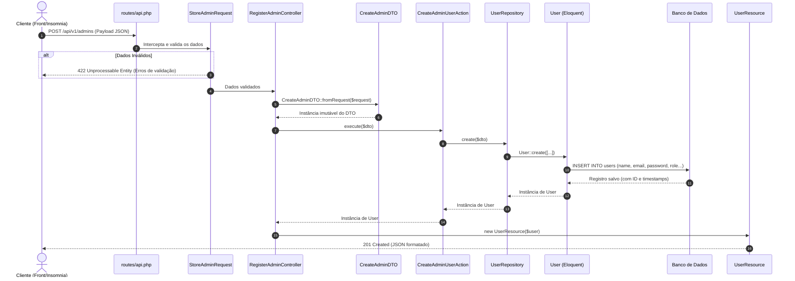

# Guia de Arquitetura Limpa e Ciclo de Vida de Requisição (API Imobiliária - Homee)

Este documento detalha a proposta de **Arquitetura Limpa (Clean Architecture Pragmática / Modular)** compatível com o ecossistema **Laravel 12**, além do passo a passo completo do fluxo de dados — desde a requisição `POST` na API até a persistência no banco de dados — utilizando como caso de uso inicial o **Cadastro de Administrador do Sistema**.

---

## 1. Sugestão de Arquitetura Limpa para Laravel

No Laravel, aplicar Clean Architecture pura (isolando 100% o Eloquent atrás de mapeadores complexos) muitas vezes gera atrito desnecessário contra o framework. A abordagem mais recomendada pela comunidade Laravel para sistemas escaláveis (como um sistema de venda e aluguel de imóveis) é a **Arquitetura em Camadas Orientada a Domínio (Modular / Actions + DTOs + Repositories)**.

### 1.1. Estrutura de Diretórios Sugerida

Podemos organizar o código dentro de `app/` dividindo responsabilidades claras entre **Apresentação (HTTP)**, **Aplicação (Use Cases / Actions)**, **Domínio (Regras, Enums, DTOs, Contratos)** e **Infraestrutura (Persistência, Models, Integrações)**:

```text
app/
├── Domain/                          # Camada de Domínio (Regras de negócio puras e contratos)
│   ├── Users/
│   │   ├── DTOs/
│   │   │   └── CreateAdminDTO.php
│   │   ├── Enums/
│   │   │   └── UserRoleEnum.php
│   │   └── Repositories/
│   │       └── UserRepositoryInterface.php
│   ├── Properties/                  # Futuro módulo de Imóveis (Venda/Aluguel)
│   │   ├── DTOs/
│   │   ├── Enums/                   # Ex: PropertyTypeEnum (SALE, RENT), PropertyStatusEnum
│   │   └── Repositories/
│   └── Contracts/                   # Futuro módulo de Contratos/Locações/Vendas
│
├── Application/                     # Camada de Aplicação (Casos de Uso / Orquestração)
│   └── Users/
│       └── Actions/                 # (ou UseCases)
│           └── CreateAdminUserAction.php
│
├── Infrastructure/                  # Camada de Infraestrutura (Banco de dados, APIs externas)
│   └── Persistence/
│       └── Eloquent/
│           └── UserRepository.php
│
├── Http/                            # Camada de Apresentação / Entrada (Delivery)
│   ├── Controllers/
│   │   └── Api/
│   │       └── V1/
│   │           └── Admin/
│   │               └── RegisterAdminController.php
│   ├── Requests/
│   │   └── Api/
│   │       └── V1/
│   │           └── Admin/
│   │               └── StoreAdminRequest.php
│   └── Resources/
│       └── Api/
│           └── V1/
│               └── UserResource.php
│
├── Models/                          # Models Eloquent nativos do Laravel
│   └── User.php
└── Providers/
    └── AppServiceProvider.php       # Bindings de Injeção de Dependência (Interface -> Implementação)
```

### 1.2. Papel de Cada Camada

1. **Http (Apresentação)**:
   - **Routes (`routes/api.php`)**: Define o endpoint e middlewares (ex: `auth:sanctum`, `throttle`).
   - **FormRequest**: Valida os dados brutos do payload (`name`, `email`, `password`, `role`) e verifica autorização antes mesmo do Controller ser executado.
   - **Controller**: Recebe o `FormRequest`, converte os dados validados em um `DTO`, chama a `Action` (Use Case) e devolve um `JsonResource` com o status HTTP adequado (`201 Created`).
   - **Resource (`JsonResource`)**: Formata o objeto de saída em JSON padronizado, garantindo que dados sensíveis (como `password`) nunca vazem.

2. **Application (Casos de Uso / Actions)**:
   - **Action / UseCase**: Classe de responsabilidade única (Single Responsibility Principle) que executa uma ação de negócio específica (ex: `CreateAdminUserAction`). Recebe um `DTO`, aplica regras de negócio da aplicação (hash de senha, disparo de eventos, transações) e chama o repositório via contrato.

3. **Domain (Coração do Negócio)**:
   - **Enums**: Tipagem forte para valores fixos do domínio (`UserRoleEnum::ADMIN`, `AGENT`, `OWNER`, `TENANT`, `BUYER`).
   - **DTO (Data Transfer Object)**: Objeto imutável (`readonly`) que transporta dados tipados entre o Controller e a Action, eliminando arrays associativos soltos ("magic arrays").
   - **Repository Interface**: Define o contrato de persistência sem acoplamento ao banco de dados específico.

4. **Infrastructure & Models (Persistência)**:
   - **Repository Implementation**: Implementa a interface do domínio utilizando o Eloquent (`User::create(...)`).
   - **Model Eloquent**: Representa a tabela no banco, casts e relacionamentos.

---

## 2. Fluxo Completo da Requisição (Visão Geral)

O diagrama abaixo ilustra o caminho exato que os dados percorrem desde o cliente até o banco de dados e de volta na resposta:



---

## 3. Passo a Passo Detalhado: Do `POST` ao `Save` no Banco

Abaixo está o detalhamento etapa por etapa de como cada componente trabalha em conjunto para cadastrar um administrador.

### Passo 1: O Payload da Requisição (`POST`)

O cliente envia uma requisição HTTP para a API com os cabeçalhos `Accept: application/json` e `Content-Type: application/json`:

- **Método**: `POST`
- **Endpoint**: `/api/v1/admins`
- **Payload (Body JSON)**:

```json
{
  "name": "Administrador Principal",
  "email": "admin@homee.com.br",
  "password": "StrongPassword@123",
  "password_confirmation": "StrongPassword@123",
  "role": "admin"
}
```

---

### Passo 2: Estrutura do Banco de Dados (Migration, Enum e Model)

Para suportar o campo `role` no sistema imobiliário, definimos um Enum nativo do PHP 8.2+ e preparamos a tabela `users`.

#### 2.1. Enum de Roles (`app/Domain/Users/Enums/UserRoleEnum.php`)
```php
<?php

namespace App\Domain\Users\Enums;

enum UserRoleEnum: string
{
    case ADMIN = 'admin';       // Administrador do sistema
    case BROKER = 'broker';     // Corretor de imóveis
    case OWNER = 'owner';       // Proprietário (Locador / Vendedor)
    case CUSTOMER = 'customer'; // Cliente (Locatário / Comprador)
}
```

#### 2.2. Migration (`database/migrations/xxxx_add_role_to_users_table.php`)
Na tabela `users` ([0001_01_01_000000_create_users_table.php](file:///Users/hugolcouto/Projetos/homee/homee.laravel/database/migrations/0001_01_01_000000_create_users_table.php)), adicionamos a coluna `role`:

```php
Schema::table('users', function (Blueprint $table) {
    $table->string('role')->default(UserRoleEnum::CUSTOMER->value)->after('email');
});
```

#### 2.3. Model Eloquent (`app/Models/User.php`)
No model [`User`](file:///Users/hugolcouto/Projetos/homee/homee.laravel/app/Models/User.php), incluímos `role` no `$fillable` e fazemos o cast automático para `UserRoleEnum` (note que o Laravel 12 já faz o hash automático da senha através do cast `'password' => 'hashed'`):

```php
protected $fillable = [
    'name',
    'email',
    'password',
    'role',
];

protected function casts(): array
{
    return [
        'email_verified_at' => 'datetime',
        'password' => 'hashed',
        'role' => UserRoleEnum::class,
    ];
}
```

---

### Passo 3: Definição da Rota (`routes/api.php`)

No Laravel 12, caso o arquivo de rotas de API ainda não esteja habilitado no [`bootstrap/app.php`](file:///Users/hugolcouto/Projetos/homee/homee.laravel/bootstrap/app.php), ele é registrado via `php artisan install:api`. A rota aponta para um Single Action Controller (ou método específico):

```php
<?php

use App\Http\Controllers\Api\V1\Admin\RegisterAdminController;
use Illuminate\Support\Facades\Route;

Route::prefix('v1')->group(function () {
    Route::post('/admins', RegisterAdminController::class)->name('api.v1.admins.store');
});
```

---

### Passo 4: Validação de Entrada (`FormRequest`)

Antes que o Controller seja chamado, o Laravel injeta e executa o `StoreAdminRequest`. Se qualquer regra falhar, o Laravel interrompe o fluxo imediatamente e retorna **HTTP 422 Unprocessable Entity** com a lista de erros.

**Arquivo**: `app/Http/Requests/Api/V1/Admin/StoreAdminRequest.php`

```php
<?php

namespace App\Http\Requests\Api\V1\Admin;

use App\Domain\Users\Enums\UserRoleEnum;
use Illuminate\Foundation\Http\FormRequest;
use Illuminate\Validation\Rule;
use Illuminate\Validation\Rules\Password;

class StoreAdminRequest extends FormRequest
{
    public function authorize(): bool
    {
        // Aqui pode ser validado se quem faz a requisição tem permissão,
        // ou true caso seja uma rota inicial protegida por middleware/token de setup.
        return true;
    }

    public function rules(): array
    {
        return [
            'name' => ['required', 'string', 'min:3', 'max:255'],
            'email' => ['required', 'string', 'email', 'max:255', 'unique:users,email'],
            'password' => ['required', 'confirmed', Password::min(8)->mixedCase()->numbers()->symbols()],
            'role' => ['required', 'string', Rule::in([UserRoleEnum::ADMIN->value])],
        ];
    }
}
```

---

### Passo 5: Transformação em DTO (Data Transfer Object)

Com os dados validados, convertemos o payload em um objeto fortemente tipado e imutável. Isso garante que a camada de Aplicação (`Action`) não dependa do objeto `Request` (HTTP), permitindo que a mesma Action seja chamada via CLI (Artisan Command), Filas (Jobs) ou Testes Automatizados.

**Arquivo**: `app/Domain/Users/DTOs/CreateAdminDTO.php`

```php
<?php

namespace App\Domain\Users\DTOs;

use App\Domain\Users\Enums\UserRoleEnum;
use App\Http\Requests\Api\V1\Admin\StoreAdminRequest;
use SensitiveParameter;

readonly class CreateAdminDTO
{
    public function __construct(
        public string $name,
        public string $email,
        #[SensitiveParameter]
        public string $password,
        public UserRoleEnum $role,
    ) {}

    public static function fromRequest(StoreAdminRequest $request): self
    {
        $validated = $request->validated();

        return new self(
            name: $validated['name'],
            email: strtolower(trim($validated['email'])),
            password: $validated['password'],
            role: UserRoleEnum::from($validated['role']),
        );
    }
}
```

---

### Passo 6: Recebimento no Controller (`RegisterAdminController`)

O Controller é **magro (Thin Controller)**: ele não contém regras de negócio nem consultas SQL. Sua única função é mediar o protocolo HTTP e a camada de Aplicação.

**Arquivo**: `app/Http/Controllers/Api/V1/Admin/RegisterAdminController.php`

```php
<?php

namespace App\Http\Controllers\Api\V1\Admin;

use App\Application\Users\Actions\CreateAdminUserAction;
use App\Domain\Users\DTOs\CreateAdminDTO;
use App\Http\Controllers\Controller;
use App\Http\Requests\Api\V1\Admin\StoreAdminRequest;
use App\Http\Resources\Api\V1\UserResource;
use Illuminate\Http\JsonResponse;
use Symfony\Component\HttpFoundation\Response;

class RegisterAdminController extends Controller
{
    public function __invoke(
        StoreAdminRequest $request,
        CreateAdminUserAction $createAdminUserAction
    ): JsonResponse {
        // 1. Converte os dados validados da requisição em um DTO imutável
        $dto = CreateAdminDTO::fromRequest($request);

        // 2. Executa o caso de uso (Action)
        $admin = $createAdminUserAction->execute($dto);

        // 3. Retorna o Resource formatado com status 201 Created
        return (new UserResource($admin))
            ->response()
            ->setStatusCode(Response::HTTP_CREATED);
    }
}
```

---

### Passo 7: Execução da Regra de Negócio (`Action` / `UseCase`)

A `CreateAdminUserAction` coordena o fluxo de negócio. Se no futuro for necessário enviar um e-mail de boas-vindas, registrar um log de auditoria ou criar permissões adicionais em outra tabela dentro de uma transação (`DB::transaction`), tudo acontece aqui.

**Arquivo**: `app/Application/Users/Actions/CreateAdminUserAction.php`

```php
<?php

namespace App\Application\Users\Actions;

use App\Domain\Users\DTOs\CreateAdminDTO;
use App\Domain\Users\Repositories\UserRepositoryInterface;
use App\Models\User;
use Illuminate\Support\Facades\DB;

class CreateAdminUserAction
{
    public function __construct(
        private readonly UserRepositoryInterface $userRepository
    ) {}

    public function execute(CreateAdminDTO $dto): User
    {
        return DB::transaction(function () use ($dto): User {
            // Persiste o usuário através do repositório
            $user = $this->userRepository->createAdmin($dto);

            // Aqui poderiam ser disparados eventos de domínio, ex:
            // event(new AdminUserRegistered($user));

            return $user;
        });
    }
}
```

---

### Passo 8: Persistência no Banco de Dados (`Repository` -> `Eloquent` -> `DB`)

A `Action` depende da interface `UserRepositoryInterface`, e o Service Container do Laravel injeta a implementação `UserRepository`.

#### 8.1. Contrato (`app/Domain/Users/Repositories/UserRepositoryInterface.php`)
```php
<?php

namespace App\Domain\Users\Repositories;

use App\Domain\Users\DTOs\CreateAdminDTO;
use App\Models\User;

interface UserRepositoryInterface
{
    public function createAdmin(CreateAdminDTO $dto): User;
}
```

#### 8.2. Implementação Eloquent (`app/Infrastructure/Persistence/Eloquent/UserRepository.php`)
Aqui ocorre a geração final dos dados para o banco (o cast `'password' => 'hashed'` no Model `User` aplica o algoritmo `bcrypt`/`argon2` automaticamente antes do `INSERT`, e o Eloquent preenche `created_at` e `updated_at`):

```php
<?php

namespace App\Infrastructure\Persistence\Eloquent;

use App\Domain\Users\DTOs\CreateAdminDTO;
use App\Domain\Users\Repositories\UserRepositoryInterface;
use App\Models\User;

class UserRepository implements UserRepositoryInterface
{
    public function createAdmin(CreateAdminDTO $dto): User
    {
        // User::create instancia o model, aplica os casts (hash de senha e enum)
        // e executa internamente o método $user->save() (INSERT INTO users ...)
        return User::create([
            'name' => $dto->name,
            'email' => $dto->email,
            'password' => $dto->password,
            'role' => $dto->role,
        ]);
    }
}
```

#### 8.3. Registro no Container de Injeção de Dependência (`app/Providers/AppServiceProvider.php`)
No método `register()` do [`AppServiceProvider`](file:///Users/hugolcouto/Projetos/homee/homee.laravel/app/Providers/AppServiceProvider.php):

```php
public function register(): void
{
    $this->app->bind(
        \App\Domain\Users\Repositories\UserRepositoryInterface::class,
        \App\Infrastructure\Persistence\Eloquent\UserRepository::class
    );
}
```

---

### Passo 9: Serialização e Resposta (`UserResource`)

Após o `save()` no banco de dados retornar a instância de `User` preenchida com o `id` gerado, o `UserResource` transforma a entidade em uma resposta JSON limpa e padronizada.

**Arquivo**: `app/Http/Resources/Api/V1/UserResource.php`

```php
<?php

namespace App\Http\Resources\Api\V1;

use Illuminate\Http\Request;
use Illuminate\Http\Resources\Json\JsonResource;

class UserResource extends JsonResource
{
    public function toArray(Request $request): array
    {
        return [
            'id' => $this->id,
            'name' => $this->name,
            'email' => $this->email,
            'role' => $this->role->value,
            'created_at' => $this->created_at?->toIso8601String(),
        ];
    }
}
```

#### Resposta HTTP Gerada (`201 Created`):
```json
{
  "data": {
    "id": 1,
    "name": "Administrador Principal",
    "email": "admin@homee.com.br",
    "role": "admin",
    "created_at": "2026-10-21T14:47:37+00:00"
  }
}
```

---

## 4. Como Essa Arquitetura Escala para Venda e Aluguel de Imóveis

Adotar esse padrão desde o cadastro do `Admin` permite que os próximos módulos do sistema imobiliário sigam exatamente o mesmo fluxo previsível e testável:

| Módulo de Domínio | Exemplos de DTOs | Exemplos de Actions (Casos de Uso) |
| :--- | :--- | :--- |
| **Users** | `CreateAdminDTO`, `CreateBrokerDTO` | `CreateAdminUserAction`, `AssignBrokerLicenseAction` |
| **Properties (Imóveis)** | `CreatePropertyDTO`, `PublishPropertyDTO` | `CreatePropertyAction`, `CalculatePropertyValuationAction`, `UploadPropertyPhotosAction` |
| **Listings (Anúncios)** | `CreateSaleListingDTO`, `CreateRentListingDTO` | `PublishForSaleAction`, `PublishForRentAction` |
| **Proposals & Contracts** | `SubmitProposalDTO`, `SignLeaseContractDTO` | `ApproveRentProposalAction`, `GenerateSaleContractAction` |

### Benefícios Principais desta Abordagem no Laravel:
- **Testabilidade**: Você pode testar `CreateAdminUserAction` unitariamente passando um `CreateAdminDTO` e um Mock de `UserRepositoryInterface`, sem precisar subir requisições HTTP.
- **Manutenibilidade**: Validações ficam apenas nos `FormRequests`, regras de negócio apenas nas `Actions`, queries apenas nos `Repositories` e formatação JSON apenas nos `Resources`.
- **Segurança**: Uso de `DTOs` tipados e `Enums` impede que um usuário comum envie `"role": "admin"` em rotas públicas de clientes, pois cada rota tem seu próprio `FormRequest` e `Action` dedicados.
