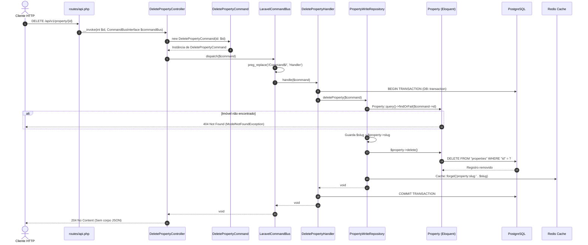

# Guia de Fluxo de Deleção de Imóvel (`DeleteProperty`) com CQRS (Da Requisição HTTP ao Delete no Banco e Redis)

Este documento detalha o ciclo de vida completo da **exclusão de um imóvel (`Property`)** aplicando o padrão **CQRS (Command Query Responsibility Segregation)** proposto no projeto `homee.laravel`, cobrindo desde a requisição HTTP (`DELETE`), roteamento, criação do `DeletePropertyCommand`, despacho pelo `LaravelCommandBus`, execução transacional no `DeletePropertyHandler`, exclusão no banco via `PropertyWriteRepository` (`delete()`), invalidação do cache Redis e resposta HTTP `204 No Content`.

> [!NOTE]
> Este guia complementa o [Guia de Atualização de Imóvel (`UpdateProperty`)](file:///Users/hugolcouto/Projetos/homee/homee.laravel/.docs/cqrs-fluxo-update-property.md) e segue os mesmos contratos de [`app/Shared/CQRS/`](file:///Users/hugolcouto/Projetos/homee/homee.laravel/app/Shared/CQRS/LaravelCommandBus.php).

---

## 1. Estrutura de Arquivos Envolvidos no Fluxo de Deleção

```text
app/
├── Shared/
│   └── CQRS/
│       ├── CommandInterface.php                                 # Contrato marcador de um Command
│       ├── CommandBusInterface.php                              # Contrato do barramento de escrita
│       └── LaravelCommandBus.php                                # Resolve DeletePropertyCommand -> DeletePropertyHandler
│
├── Domain/
│   └── Users/
│       └── Repositories/
│           └── PropertyWriteRepositoryInterface.php             # Contrato de escrita (+ método deleteProperty)
│
├── Application/
│   └── Users/
│       └── Commands/
│           └── DeleteProperty/
│               ├── DeletePropertyCommand.php                    # DTO imutável contendo o identificador do imóvel
│               └── DeletePropertyHandler.php                    # Orquestra DB::transaction e chama o WriteRepository
│
├── Infrastructure/
│   └── Persistence/
│       └── Eloquent/
│           └── Write/
│               └── PropertyWriteRepository.php                  # Busca o Property, executa $property->delete() e limpa o Redis
│
├── Http/
│   └── Controllers/
│       └── Api/
│           └── V1/
│               └── Property/
│                   └── DeletePropertyController.php             # Single Action Controller (__invoke) -> 204 No Content
│
└── Models/
    └── Property.php                                             # Model Eloquent
```

---

## 2. Diagrama de Sequência: Do `DELETE /api/v1/property/{id}` ao `DELETE` no Banco



---

## 3. Passo a Passo da Implementação

### Passo 1: Entrada da Requisição HTTP (`DELETE`)

O cliente envia uma requisição HTTP `DELETE` passando o `{id}` (ou `{slug}`) na URL:

* **Endpoint:** `DELETE /api/v1/property/{id}`
* **Headers:**
  * `Accept: application/json`
* **Body:** Nenhum (vazio).

---

### Passo 2: Registro da Rota em [`routes/api.php`](file:///Users/hugolcouto/Projetos/homee/homee.laravel/routes/api.php)

No grupo `property` dentro de `routes/api.php`, adicione a rota `DELETE` apontando para o Single Action Controller `DeletePropertyController`:

```php
use App\Http\Controllers\Api\V1\Property\DeletePropertyController;
use App\Http\Controllers\Api\V1\Property\ListPropertiesController;
use App\Http\Controllers\Api\V1\Property\RegisterPropertyController;
use App\Http\Controllers\Api\V1\Property\ShowPropertyController;
use Illuminate\Support\Facades\Route;

Route::prefix("property")->group(function () {
    Route::post('/create', RegisterPropertyController::class)->name('api.v1.properties.store');
    Route::delete('/{id}', DeletePropertyController::class)
        ->whereNumber('id')
        ->name('api.v1.properties.destroy');
    Route::get("/{slug}", ShowPropertyController::class)->name('api.v1.properties.getBySlug');
    Route::get("/", ListPropertiesController::class)->name('api.v1.properties.list');
});
```

> [!TIP]
> A restrição `->whereNumber('id')` (já usada nas rotas de `admins` e `customer` em [`routes/api.php`](file:///Users/hugolcouto/Projetos/homee/homee.laravel/routes/api.php#L17-L32)) garante que o parâmetro `{id}` aceite apenas números inteiros. Se você preferir deletar pelo `{slug}`, basta usar `Route::delete('/{slug}', DeletePropertyController::class)` e passar `string $slug` no `DeletePropertyCommand`.

---

### Passo 3: Construção do Command (`DeletePropertyCommand`)

Como a exclusão precisa apenas do identificador do imóvel, o `DeletePropertyCommand` é uma classe enxuta que implementa [`CommandInterface`](file:///Users/hugolcouto/Projetos/homee/homee.laravel/app/Shared/CQRS/CommandInterface.php):

**Arquivo:** `app/Application/Users/Commands/DeleteProperty/DeletePropertyCommand.php`

```php
<?php

namespace App\Application\Users\Commands\DeleteProperty;

use App\Shared\CQRS\CommandInterface;

class DeletePropertyCommand implements CommandInterface
{
    public function __construct(
        public int $id
    ) {}
}
```

---

### Passo 4: O Controller (`DeletePropertyController`)

O Controller recebe o `$id` da rota, instancia o `DeletePropertyCommand`, despacha para o [`CommandBusInterface`](file:///Users/hugolcouto/Projetos/homee/homee.laravel/app/Shared/CQRS/CommandBusInterface.php) e retorna `204 No Content`:

**Arquivo:** `app/Http/Controllers/Api/V1/Property/DeletePropertyController.php`

```php
<?php

namespace App\Http\Controllers\Api\V1\Property;

use App\Application\Users\Commands\DeleteProperty\DeletePropertyCommand;
use App\Http\Controllers\Controller;
use App\Shared\CQRS\CommandBusInterface;
use Illuminate\Http\Response;

class DeletePropertyController extends Controller
{
    public function __invoke(
        int $id,
        CommandBusInterface $commandBus
    ): Response {
        $command = new DeletePropertyCommand(id: $id);

        $commandBus->dispatch($command);

        return response()->noContent(); // HTTP 204 No Content
    }
}
```

---

### Passo 5: Resolução Automática pelo [`LaravelCommandBus`](file:///Users/hugolcouto/Projetos/homee/homee.laravel/app/Shared/CQRS/LaravelCommandBus.php)

Ao receber `DeletePropertyCommand`, o [`LaravelCommandBus`](file:///Users/hugolcouto/Projetos/homee/homee.laravel/app/Shared/CQRS/LaravelCommandBus.php#L16-L26) substitui o sufixo `Command` por `Handler` e resolve automaticamente a classe:
* `App\Application\Users\Commands\DeleteProperty\DeletePropertyHandler`

---

### Passo 6: Execução Transacional no `CommandHandler` (`DeletePropertyHandler`)

O `DeletePropertyHandler` encapsula a operação em `DB::transaction()` e delega a exclusão para o repositório de escrita:

**Arquivo:** `app/Application/Users/Commands/DeleteProperty/DeletePropertyHandler.php`

```php
<?php

namespace App\Application\Users\Commands\DeleteProperty;

use App\Domain\Users\Repositories\PropertyWriteRepositoryInterface;
use Illuminate\Support\Facades\DB;

class DeletePropertyHandler
{
    public function __construct(
        private readonly PropertyWriteRepositoryInterface $propertyWriteRepository
    ) {}

    public function handle(DeletePropertyCommand $command): void
    {
        DB::transaction(function () use ($command): void {
            $this->propertyWriteRepository->deleteProperty($command);
        });
    }
}
```

---

### Passo 7: Contrato e Exclusão no Banco (`PropertyWriteRepository`)

#### 7.1. Atualizar o Contrato [`PropertyWriteRepositoryInterface.php`](file:///Users/hugolcouto/Projetos/homee/homee.laravel/app/Domain/Users/Repositories/PropertyWriteRepositoryInterface.php)

Adicione o método `deleteProperty`:

```php
<?php

namespace App\Domain\Users\Repositories;

use App\Application\Users\Commands\CreateProperty\CreatePropertyCommand;
use App\Application\Users\Commands\DeleteProperty\DeletePropertyCommand;
use App\Models\Property;

interface PropertyWriteRepositoryInterface
{
    public function createProperty(CreatePropertyCommand $command): Property;

    public function deleteProperty(DeletePropertyCommand $command): void;
}
```

#### 7.2. Implementar no [`PropertyWriteRepository.php`](file:///Users/hugolcouto/Projetos/homee/homee.laravel/app/Infrastructure/Persistence/Eloquent/Write/PropertyWriteRepository.php)

Por que usar `findOrFail()` antes do `$property->delete()` em vez de `Property::destroy($id)` direto?
1. **Garantia de `404 Not Found`:** Se o cliente tentar deletar um `id` que não existe, `findOrFail()` lança `ModelNotFoundException` e a API responde `404` automaticamente.
2. **Acesso ao `slug` para limpar o Redis:** Carregando o model antes de excluir, temos acesso a `$property->slug` para remover imediatamente a chave `property:slug:{slug}` do cache Redis, impedindo que um imóvel já excluído continue acessível via cache na rota `GET /api/v1/property/{slug}`.

```php
<?php

namespace App\Infrastructure\Persistence\Eloquent\Write;

use App\Application\Users\Commands\CreateProperty\CreatePropertyCommand;
use App\Application\Users\Commands\DeleteProperty\DeletePropertyCommand;
use App\Domain\Users\Repositories\PropertyWriteRepositoryInterface;
use App\Models\Property;
use Illuminate\Support\Facades\Cache;

class PropertyWriteRepository implements PropertyWriteRepositoryInterface
{
    public function createProperty(CreatePropertyCommand $command): Property
    {
        $property = new Property([
            'title' => $command->title,
            'slug' => $command->slug,
            'valueInCents' => $command->valueInCents,
            'description' => $command->description,
            'amenities' => $command->amenities,
            'location' => $command->location,
            'transactionType' => $command->transactionType,
        ]);

        $property->save();

        return $property;
    }

    public function deleteProperty(DeletePropertyCommand $command): void
    {
        $property = Property::query()->findOrFail($command->id);

        $slug = $property->slug;

        $property->delete();

        // Remove imediatamente o imóvel excluído do cache Redis
        Cache::forget('property:slug:' . $slug);
    }
}
```

#### 7.3. O que acontece internamente no `$property->delete()`
1. **Verificação de Existência:** O Eloquent verifica que `$property->exists` é `true` e obtém a chave primária (`id`).
2. **Query SQL Executada no PostgreSQL:**
   ```sql
   DELETE FROM "properties" WHERE "id" = 1;
   ```
3. **Invalidação no Redis:** `Cache::forget('property:slug:' . $slug)` executa `DEL` na chave correspondente do Redis (DB `1`), evitando leituras fantasmas (*stale reads*).
4. **Commit da Transação:** O `DB::transaction` confirma a remoção e o `DeletePropertyController` responde com `HTTP 204 No Content`.
