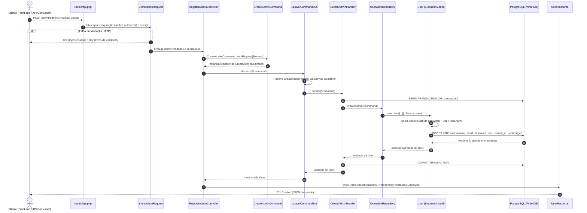

# Guia de Fluxo de Escrita de Dados com CQRS (Do POST/PUT/DELETE na API até o Save no Banco)

Este documento detalha o ciclo de vida completo de uma **operação de escrita (Write Model / Command Side)** aplicando o padrão **CQRS (Command Query Responsibility Segregation)** no **Laravel 12**, cobrindo passo a passo desde a entrada da requisição HTTP na API até a persistência transacional (`save`) no banco de dados PostgreSQL e o retorno da resposta formatada.

> [!NOTE]
> Este guia complementa a [Análise Arquitetural e Implementação de CQRS](file:///Users/hugolcouto/Projetos/homee/homee.laravel/.docs/analise-projeto-e-implementacao-cqrs.md) e o documento de [Fluxo de Leitura de Dados com CQRS](file:///Users/hugolcouto/Projetos/homee/homee.laravel/.docs/cqrs-fluxo-leitura-dados.md).

---

## 1. Visão Geral do Lado de Escrita (Command Side) no CQRS

No padrão **CQRS**, toda operação que **altera o estado do sistema** (criar um administrador, cadastrar um imóvel para venda/aluguel, aprovar uma proposta ou assinar um contrato) é tratada exclusivamente pelo **Write Side (Lado de Escrita)**.

### 1.1. Princípios do Fluxo de Escrita
1. **Intenção Explícita de Negócio (`Command`)**: Em vez de enviar arrays genéricos, a requisição HTTP é convertida em um objeto imutável que representa uma intenção clara de mudança de estado (ex: `CreateAdminCommand`, `PublishPropertyForRentCommand`).
2. **Desacoplamento via Barramento (`CommandBus`)**: O Controller não conhece quem executa a regra de negócio; ele apenas despacha o `Command` para o `CommandBusInterface`.
3. **Execução Transacional (`CommandHandler`)**: Um único `Handler` é responsável por processar aquele `Command`, garantindo atomicidade (`DB::transaction`), validações de domínio e disparo de eventos colaterais.
4. **Repositório Exclusivo de Escrita (`WriteRepository`)**: O contrato de persistência contém **apenas métodos de mutação** (`create`, `update`, `delete`), mantendo o modelo Eloquent focado em integridade de dados, casts e relacionamentos transacionais.

---

## 2. Estrutura de Diretórios (Escrita CQRS)

Abaixo estão os arquivos envolvidos exclusivamente no fluxo de escrita dentro de `app/`:

```text
app/
├── Shared/
│   └── CQRS/
│       ├── CommandInterface.php                 # Contrato marcador de um Command
│       ├── CommandBusInterface.php              # Contrato do barramento de escrita
│       └── LaravelCommandBus.php                # Resolução automática Command -> Handler
│
├── Domain/
│   └── Users/
│       ├── Enums/
│       │   └── UserRoleEnum.php                 # Papéis do sistema (admin, broker, owner, customer)
│       ├── Events/
│       │   └── AdminRegisteredEvent.php         # Evento de domínio disparado após o save
│       └── Repositories/
│           └── UserWriteRepositoryInterface.php # Contrato estrito para persistência (INSERT/UPDATE/DELETE)
│
├── Application/
│   └── Users/
│       └── Commands/
│           └── CreateAdmin/
│               ├── CreateAdminCommand.php       # Objeto imutável com os dados da intenção de escrita
│               └── CreateAdminHandler.php       # Orquestrador da regra de negócio e transação
│
├── Infrastructure/
│   └── Persistence/
│       └── Eloquent/
│           └── UserWriteRepository.php          # Implementação Eloquent que executa o save no banco
│
├── Http/
│   ├── Controllers/
│   │   └── Api/
│   │       └── V1/
│   │           └── Admin/
│   │               └── RegisterAdminController.php
│   ├── Requests/
│   │   └── Api/
│   │       └── V1/
│   │           └── Admin/
│   │               └── StoreAdminRequest.php
│   └── Resources/
│       └── Api/
│           └── V1/
│               └── UserResource.php
│
├── Models/
│   └── User.php                                 # Model Eloquent (Casts, Hash de Senha e Fillable)
└── Providers/
    └── AppServiceProvider.php                   # Bindings do CommandBus e UserWriteRepository
```

---

## 3. Diagrama de Sequência: Da Requisição HTTP ao Save no Banco

O diagrama abaixo ilustra o caminho exato que os dados percorrem no fluxo de escrita utilizando CQRS:



---

## 4. Passo a Passo Detalhado do Fluxo de Escrita

A seguir, percorremos cada camada desde o envio do JSON pelo cliente até o `INSERT` no PostgreSQL.

### Passo 1: Entrada da Requisição HTTP (`POST`)

O cliente (Front-end Web, App Mobile ou Insomnia/Postman) envia uma requisição HTTP `POST` para cadastrar um novo administrador:

- **Endpoint**: `POST /api/v1/admins`
- **Headers**:
  - `Accept: application/json`
  - `Content-Type: application/json`
- **Payload (Body JSON)**:
```json
{
  "name": "Administrador Principal",
  "email": "admin@homee.com.br",
  "password": "StrongPassword@123",
  "password_confirmation": "StrongPassword@123",
  "role": "admin"
}
```

---

### Passo 2: Roteamento (`routes/api.php`)

A requisição entra pelo [`bootstrap/app.php`](file:///Users/hugolcouto/Projetos/homee/homee.laravel/bootstrap/app.php) e é direcionada para o arquivo [`routes/api.php`](file:///Users/hugolcouto/Projetos/homee/homee.laravel/routes/api.php), que mapeia o verbo `POST` para o Single Action Controller [`RegisterAdminController`](file:///Users/hugolcouto/Projetos/homee/homee.laravel/app/Http/Controllers/Api/V1/Admin/RegisterAdminController.php):

```php
<?php

use App\Http\Controllers\Api\V1\Admin\RegisterAdminController;
use App\Http\Controllers\Api\V1\Admin\ShowAdminController;
use Illuminate\Support\Facades\Route;

Route::prefix('v1')->group(function () {
    Route::prefix('admins')->group(function () {
        Route::post('/', RegisterAdminController::class)->name('api.v1.admins.store');
        Route::get('/{id}', ShowAdminController::class)->name('api.v1.admins.getById');
    });
});
```

---

### Passo 3: Barreira de Validação (`StoreAdminRequest`)

Antes que o método `__invoke` do Controller seja executado, o container do Laravel resolve o [`StoreAdminRequest`](file:///Users/hugolcouto/Projetos/homee/homee.laravel/app/Http/Requests/Api/V1/Admin/StoreAdminRequest.php). Ele valida formato, obrigatoriedade, unicidade do e-mail e força da senha:

**Arquivo**: `app/Http/Requests/Api/V1/Admin/StoreAdminRequest.php`

```php
<?php

namespace App\Http\Requests\Api\V1\Admin;

use App\Domain\Users\Enums\UserRoleEnum;
use Illuminate\Foundation\Http\FormRequest;
use Illuminate\Validation\Rule;
use Illuminate\Validation\Rules\Password;

class StoreAdminRequest extends FormRequest
{
    public function authorize(): bool
    {
        return true;
    }

    public function rules(): array
    {
        return [
            'name' => ['required', 'string', 'min:3', 'max:255'],
            'email' => ['required', 'string', 'email', 'max:255', 'unique:users,email'],
            'password' => ['required', 'confirmed', Password::min(8)->mixedCase()->numbers()->symbols()],
            'role' => ['required', 'string', Rule::in([UserRoleEnum::ADMIN->value])],
        ];
    }
}
```

- **Se os dados forem inválidos**: O fluxo é abortado imediatamente e o Laravel retorna `422 Unprocessable Entity` sem tocar no `CommandBus` nem abrir transação no banco.
- **Se os dados forem válidos**: O fluxo avança para o Controller.

---

### Passo 4: Criação do `Command` (`CreateAdminCommand`)

No CQRS, o Controller transforma os dados validados da requisição em um **Command** (`CreateAdminCommand`) que implementa `CommandInterface`.
- Ele é `readonly` (imutável: ninguém pode adulterar seus dados no meio do caminho).
- Utiliza `#[SensitiveParameter]` na senha para que ela nunca apareça em logs de *Stack Trace* em caso de exceção.
- Normaliza dados de entrada (ex: `strtolower(trim($email))`) e converte strings primitivas para objetos de domínio como [`UserRoleEnum`](file:///Users/hugolcouto/Projetos/homee/homee.laravel/app/Domain/Users/Enums/UserRoleEnum.php).

**Arquivo**: `app/Application/Users/Commands/CreateAdmin/CreateAdminCommand.php`

```php
<?php

namespace App\Application\Users\Commands\CreateAdmin;

use App\Domain\Users\Enums\UserRoleEnum;
use App\Http\Requests\Api\V1\Admin\StoreAdminRequest;
use App\Shared\CQRS\CommandInterface;
use SensitiveParameter;

readonly class CreateAdminCommand implements CommandInterface
{
    public function __construct(
        public string $name,
        public string $email,
        #[SensitiveParameter]
        public string $password,
        public UserRoleEnum $role,
    ) {}

    public static function fromRequest(StoreAdminRequest $request): self
    {
        $validated = $request->validated();

        return new self(
            name: trim($validated['name']),
            email: strtolower(trim($validated['email'])),
            password: $validated['password'],
            role: UserRoleEnum::from($validated['role']),
        );
    }
}
```

---

### Passo 5: Despacho no Controller (`RegisterAdminController`)

O Controller permanece extremamente enxuto (*Thin Controller*). Ele instancia o `CreateAdminCommand` e o despacha através do `CommandBusInterface`:

**Arquivo**: `app/Http/Controllers/Api/V1/Admin/RegisterAdminController.php`

```php
<?php

namespace App\Http\Controllers\Api\V1\Admin;

use App\Application\Users\Commands\CreateAdmin\CreateAdminCommand;
use App\Http\Controllers\Controller;
use App\Http\Requests\Api\V1\Admin\StoreAdminRequest;
use App\Http\Resources\Api\V1\UserResource;
use App\Shared\CQRS\CommandBusInterface;
use Illuminate\Http\JsonResponse;
use Symfony\Component\HttpFoundation\Response;

class RegisterAdminController extends Controller
{
    public function __invoke(
        StoreAdminRequest $request,
        CommandBusInterface $commandBus
    ): JsonResponse {
        // 1. Empacota os dados validados em um Command imutável
        $command = CreateAdminCommand::fromRequest($request);

        // 2. Despacha o Command para o barramento de escrita
        $admin = $commandBus->dispatch($command);

        // 3. Formata a entidade persistida com UserResource e retorna HTTP 201 Created
        return (new UserResource($admin))
            ->response()
            ->setStatusCode(Response::HTTP_CREATED);
    }
}
```

---

### Passo 6: Roteamento Interno pelo `CommandBus` (`LaravelCommandBus`)

O `LaravelCommandBus` recebe o `CreateAdminCommand`, descobre automaticamente qual é o seu `Handler` correspondente (`CreateAdminHandler`), resolve suas dependências via Service Container do Laravel e invoca o método `handle()`:

**Contratos e Implementação (`app/Shared/CQRS/`)**:

```php
<?php

namespace App\Shared\CQRS;

interface CommandInterface {}
```

```php
<?php

namespace App\Shared\CQRS;

interface CommandBusInterface
{
    public function dispatch(CommandInterface $command): mixed;
}
```

```php
<?php

namespace App\Shared\CQRS;

use Illuminate\Contracts\Container\Container;
use RuntimeException;

class LaravelCommandBus implements CommandBusInterface
{
    public function __construct(
        private readonly Container $container
    ) {}

    public function dispatch(CommandInterface $command): mixed
    {
        // Converte: App\Application\Users\Commands\CreateAdmin\CreateAdminCommand
        // Para:     App\Application\Users\Commands\CreateAdmin\CreateAdminHandler
        $handlerClass = preg_replace('/Command$/', 'Handler', $command::class);

        if (! class_exists($handlerClass)) {
            throw new RuntimeException("Handler [{$handlerClass}] não encontrado para o Command [" . $command::class . "].");
        }

        $handler = $this->container->make($handlerClass);

        return $handler->handle($command);
    }
}
```

> [!TIP]
> **Por que usar um `CommandBus` no fluxo de escrita?**
> Como todas as operações de escrita do sistema passam pelo método `dispatch()`, você pode adicionar facilmente comportamentos transversais (*Cross-Cutting Concerns*) em um único lugar, como logs de auditoria automática de quem alterou qual registro, métricas de tempo de escrita ou *middlewares* de transação.

---

### Passo 7: Orquestração e Transação no `CommandHandler` (`CreateAdminHandler`)

O `CreateAdminHandler` é o coração da camada de aplicação para escrita. Ele abre uma transação de banco de dados (`DB::transaction`), chama o repositório de escrita (`UserWriteRepositoryInterface`) e pode disparar eventos de domínio caso outras partes do sistema precisem reagir à criação (ex: envio de e-mail de boas-vindas ou atualização de cache).

**Arquivo**: `app/Application/Users/Commands/CreateAdmin/CreateAdminHandler.php`

```php
<?php

namespace App\Application\Users\Commands\CreateAdmin;

use App\Domain\Users\Repositories\UserWriteRepositoryInterface;
use App\Models\User;
use Illuminate\Support\Facades\DB;

class CreateAdminHandler
{
    public function __construct(
        private readonly UserWriteRepositoryInterface $userWriteRepository
    ) {}

    public function handle(CreateAdminCommand $command): User
    {
        return DB::transaction(function () use ($command): User {
            // 1. Executa a persistência através do repositório exclusivo de escrita
            $user = $this->userWriteRepository->createAdmin($command);

            // 2. Ponto ideal para disparar Eventos de Domínio (após o save transacional):
            // event(new AdminRegisteredEvent($user));

            return $user;
        });
    }
}
```

---

### Passo 8: Persistência e `Save` no Banco (`UserWriteRepository` + `User` Model)

O `CreateAdminHandler` depende exclusivamente da interface `UserWriteRepositoryInterface`, respeitando a Inversão de Dependência (DIP) e a Segregação de Interfaces (ISP).

#### 8.1. Contrato de Escrita (`app/Domain/Users/Repositories/UserWriteRepositoryInterface.php`)
```php
<?php

namespace App\Domain\Users\Repositories;

use App\Application\Users\Commands\CreateAdmin\CreateAdminCommand;
use App\Models\User;

interface UserWriteRepositoryInterface
{
    public function createAdmin(CreateAdminCommand $command): User;
}
```

#### 8.2. Implementação Eloquent (`app/Infrastructure/Persistence/Eloquent/UserWriteRepository.php`)
```php
<?php

namespace App\Infrastructure\Persistence\Eloquent;

use App\Application\Users\Commands\CreateAdmin\CreateAdminCommand;
use App\Domain\Users\Repositories\UserWriteRepositoryInterface;
use App\Models\User;

class UserWriteRepository implements UserWriteRepositoryInterface
{
    public function createAdmin(CreateAdminCommand $command): User
    {
        $user = new User([
            'name' => $command->name,
            'email' => $command->email,
            'password' => $command->password,
            'role' => $command->role,
        ]);

        // Executa o INSERT no PostgreSQL aplicando os casts do Model User
        $user->save();

        return $user;
    }
}
```

#### 8.3. O que acontece internamente no `$user->save()` (Model [`User`](file:///Users/hugolcouto/Projetos/homee/homee.laravel/app/Models/User.php))
Quando `$user->save()` (ou `User::create(...)`) é executado:
1. **Mutators / Casts de Escrita**:
   - O cast `'password' => 'hashed'` definido em [`User::casts()`](file:///Users/hugolcouto/Projetos/homee/homee.laravel/app/Models/User.php#L45-L52) transforma a senha em texto plano em um hash seguro (`bcrypt` / `argon2id`).
   - O cast `'role' => UserRoleEnum::class` extrai o valor escalar `'admin'` do Enum para armazenamento na coluna `VARCHAR`.
2. **Timestamps**:
   - O Eloquent preenche automaticamente `created_at` e `updated_at` com o horário UTC atual.
3. **Execução SQL no PostgreSQL**:
   ```sql
   INSERT INTO "users" ("name", "email", "password", "role", "updated_at", "created_at")
   VALUES ('Administrador Principal', 'admin@homee.com.br', '$2y$12$...', 'admin', '2026-10-22 14:23:00', '2026-10-22 14:23:00')
   RETURNING "id";
   ```
4. **Hidratação do ID**:
   - O PostgreSQL retorna o `id` gerado pela sequência (`RETURNING "id"`), que é atribuído à propriedade `$user->id`, e o `DB::transaction` executa o `COMMIT`.

---

### Passo 9: Serialização de Saída (`UserResource`) e Resposta HTTP `201 Created`

Com o objeto `User` salvo e retornado pelo `CommandBus`, o Controller o envolve no [`UserResource`](file:///Users/hugolcouto/Projetos/homee/homee.laravel/app/Http/Resources/Api/V1/UserResource.php), garantindo que campos sensíveis (`password`, `remember_token`) jamais saiam na resposta da API:

**Arquivo**: `app/Http/Resources/Api/V1/UserResource.php`

```php
<?php

namespace App\Http\Resources\Api\V1;

use Illuminate\Http\Request;
use Illuminate\Http\Resources\Json\JsonResource;

class UserResource extends JsonResource
{
    public function toArray(Request $request): array
    {
        return [
            'id' => $this->id,
            'name' => $this->name,
            'email' => $this->email,
            'role' => $this->role->value,
            'created_at' => $this->created_at?->toIso8601String(),
        ];
    }
}
```

#### JSON Final Entregue ao Cliente (`HTTP 201 Created`):
```json
{
  "data": {
    "id": 1,
    "name": "Administrador Principal",
    "email": "admin@homee.com.br",
    "role": "admin",
    "created_at": "2026-10-22T14:23:00+00:00"
  }
}
```

---

## 5. Outros Exemplos de Escrita (Commands) no Domínio Imobiliário

Seguindo exatamente esta mesma estrutura, qualquer nova operação de escrita (`POST`, `PUT`, `PATCH`, `DELETE`) no sistema `homee.laravel` seguirá o padrão:

| Operação HTTP | Command (`Application/.../Commands`) | CommandHandler | O que faz no `WriteRepository` (`save`) |
| :--- | :--- | :--- | :--- |
| `POST /api/v1/admins` | `CreateAdminCommand` | `CreateAdminHandler` | Insere novo admin na tabela `users` |
| `PUT /api/v1/admins/{id}` | `UpdateAdminCommand` | `UpdateAdminHandler` | Busca model, altera atributos e chama `$user->save()` |
| `POST /api/v1/properties` | `CreatePropertyCommand` | `CreatePropertyHandler` | Salva o imóvel (`$property->save()`) e endereço em transação |
| `PATCH /api/v1/properties/{id}/publish` | `PublishPropertyCommand` | `PublishPropertyHandler` | Valida fotos mínimas, muda status para `PUBLISHED` e chama `$property->save()` |
| `POST /api/v1/proposals` | `SubmitProposalCommand` | `SubmitProposalHandler` | Salva proposta de compra/locação e dispara notificação ao corretor |
