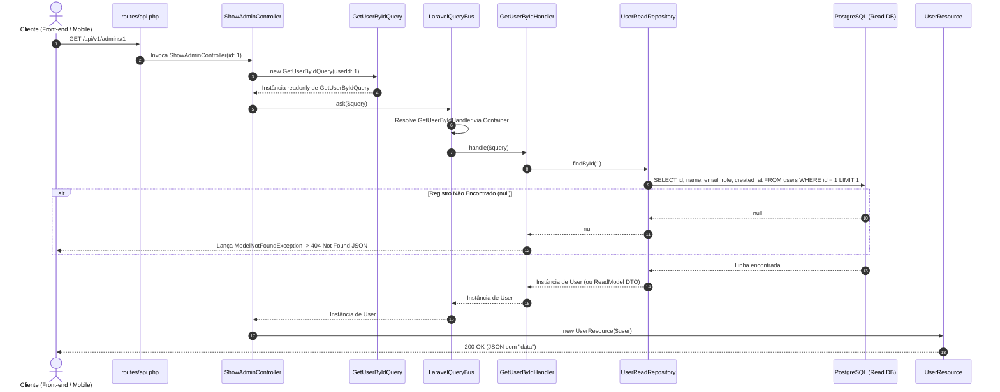
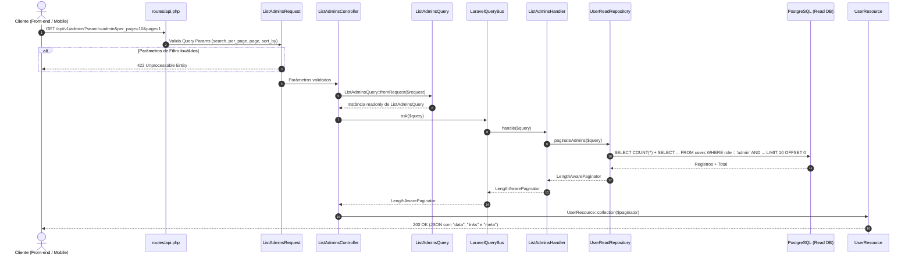

# Guia de Fluxo de Leitura de Dados com CQRS (Do GET na API até a Busca no Banco e Visualização)

Este documento detalha o ciclo de vida completo de uma **operação de leitura (Read Model / Query Side)** aplicando o padrão **CQRS (Command Query Responsibility Segregation)** no **Laravel 12**, cobrindo passo a passo desde a requisição HTTP `GET` enviada pelo Front-end até a execução do `SELECT` otimizado no banco de dados PostgreSQL e a entrega do JSON para renderização na tela.

> [!NOTE]
> Este guia complementa a [Análise Arquitetural e Implementação de CQRS](file:///Users/hugolcouto/Projetos/homee/homee.laravel/.docs/analise-projeto-e-implementacao-cqrs.md) e faz par com o documento de [Fluxo de Escrita de Dados com CQRS](file:///Users/hugolcouto/Projetos/homee/homee.laravel/.docs/cqrs-fluxo-escrita-dados.md).

---

## 1. Visão Geral do Lado de Leitura (Query Side) no CQRS

No padrão **CQRS**, toda operação que **apenas consulta dados sem produzir efeitos colaterais** (visualizar um administrador por ID, listar administradores paginados, buscar imóveis para aluguel com filtros de preço e localização) pertence exclusivamente ao **Read Side (Lado de Leitura)**.

### 1.1. Princípios do Fluxo de Leitura
1. **Zero Efeito Colateral (`Side-Effect Free`)**: Uma `Query` nunca altera estados no banco de dados, nunca abre transações de escrita (`DB::transaction`) e nunca dispara eventos de mutação de domínio.
2. **Critérios Explícitos de Consulta (`Query`)**: Os parâmetros de rota (`{id}`) ou de *Query String* (`?search=...&role=...&page=1`) são encapsulados em um objeto imutável que implementa `QueryInterface` (ex: `GetUserByIdQuery`, `ListAdminsQuery`).
3. **Desacoplamento via Barramento (`QueryBus`)**: O Controller entrega o objeto `Query` para o `QueryBusInterface::ask($query)` e recebe os dados prontos para serialização.
4. **Repositório Exclusivo de Leitura (`ReadRepository`)**: O `UserReadRepository` contém apenas consultas otimizadas (`SELECT` de colunas necessárias, *Eager Loading* com `with()`, paginação e cache), totalmente independente do repositório de escrita.

---

## 2. Estrutura de Diretórios (Leitura CQRS)

Abaixo estão os arquivos envolvidos exclusivamente no fluxo de leitura e consulta dentro de `app/`:

```text
app/
├── Shared/
│   └── CQRS/
│       ├── QueryInterface.php                  # Contrato marcador de uma Query
│       ├── QueryBusInterface.php               # Contrato do barramento de leitura
│       └── LaravelQueryBus.php                 # Resolução automática Query -> Handler
│
├── Domain/
│   └── Users/
│       ├── Enums/
│       │   └── UserRoleEnum.php                # Enum usado para filtrar roles válidas
│       └── Repositories/
│           └── UserReadRepositoryInterface.php # Contrato estrito para consultas (findById, paginate)
│
├── Application/
│   └── Users/
│       └── Queries/
│           ├── GetUserById/
│           │   ├── GetUserByIdQuery.php        # Objeto imutável contendo o ID buscado
│           │   └── GetUserByIdHandler.php      # Handler que busca o registro ou lança 404
│           └── ListAdmins/
│               ├── ListAdminsQuery.php         # Objeto imutável com filtros, ordenação e paginação
│               └── ListAdminsHandler.php       # Handler que retorna a lista paginada
│
├── Infrastructure/
│   └── Persistence/
│       └── Eloquent/
│           └── UserReadRepository.php          # Implementação focada em SELECTs otimizados e rápidos
│
├── Http/
│   ├── Controllers/
│   │   └── Api/
│   │       └── V1/
│   │           └── Admin/
│   │               ├── ShowAdminController.php # GET /api/v1/admins/{id}
│   │               └── ListAdminsController.php# GET /api/v1/admins
│   ├── Requests/
│   │   └── Api/
│   │       └── V1/
│   │           └── Admin/
│   │               └── ListAdminsRequest.php   # Valida Query Params (search, page, per_page, sort)
│   └── Resources/
│       └── Api/
│           └── V1/
│               └── UserResource.php            # Formata item único ou coleção paginada em JSON
│
└── Providers/
    └── AppServiceProvider.php                  # Bindings do QueryBus e UserReadRepository
```

---

## 3. Diagramas de Sequência do Fluxo de Leitura

Em uma API REST com CQRS, temos dois fluxos principais de leitura: **Busca por ID (Detalhe)** e **Listagem com Filtros e Paginação**.

### 3.1. Cenário A: Busca de Registro Único por ID (`GET /api/v1/admins/{id}`)



### 3.2. Cenário B: Listagem com Filtros e Paginação (`GET /api/v1/admins`)



---

## 4. Passo a Passo Detalhado do Fluxo de Leitura

A seguir, percorremos cada camada desde a chamada HTTP `GET` até a execução da consulta SQL e retorno do JSON.

### Passo 1: Requisição HTTP `GET` e Roteamento (`routes/api.php`)

No arquivo [`routes/api.php`](file:///Users/hugolcouto/Projetos/homee/homee.laravel/routes/api.php), registramos os endpoints de leitura apontando para seus Single Action Controllers:

```php
<?php

use App\Http\Controllers\Api\V1\Admin\ListAdminsController;
use App\Http\Controllers\Api\V1\Admin\RegisterAdminController;
use App\Http\Controllers\Api\V1\Admin\ShowAdminController;
use Illuminate\Support\Facades\Route;

Route::prefix('v1')->group(function () {
    Route::prefix('admins')->group(function () {
        // Escrita (Command)
        Route::post('/', RegisterAdminController::class)->name('api.v1.admins.store');

        // Leitura (Queries)
        Route::get('/', ListAdminsController::class)->name('api.v1.admins.index');
        Route::get('/{id}', ShowAdminController::class)
            ->whereNumber('id')
            ->name('api.v1.admins.getById');
    });
});
```

---

### Passo 2: Validação dos Parâmetros de Consulta (`ListAdminsRequest`)

Nas rotas de listagem que recebem filtros via *Query String* (`?search=hugo&per_page=15&sort_by=name&sort_dir=asc`), validamos os parâmetros antes de construir a `Query` para proteger o banco de dados contra valores maliciosos ou paginações abusivas:

**Arquivo**: `app/Http/Requests/Api/V1/Admin/ListAdminsRequest.php`

```php
<?php

namespace App\Http\Requests\Api\V1\Admin;

use Illuminate\Foundation\Http\FormRequest;
use Illuminate\Validation\Rule;

class ListAdminsRequest extends FormRequest
{
    public function authorize(): bool
    {
        return true;
    }

    public function rules(): array
    {
        return [
            'search' => ['nullable', 'string', 'max:100'],
            'per_page' => ['nullable', 'integer', 'min:1', 'max:100'],
            'page' => ['nullable', 'integer', 'min:1'],
            'sort_by' => ['nullable', 'string', Rule::in(['id', 'name', 'email', 'created_at'])],
            'sort_dir' => ['nullable', 'string', Rule::in(['asc', 'desc'])],
        ];
    }
}
```

---

### Passo 3: Construção dos Objetos `Query`

Os objetos `Query` implementam `QueryInterface` e carregam de forma imutável (`readonly`) todos os parâmetros necessários para que o `QueryHandler` realize a busca.

#### 3.1. `GetUserByIdQuery` (Busca por ID)
**Arquivo**: `app/Application/Users/Queries/GetUserById/GetUserByIdQuery.php`

```php
<?php

namespace App\Application\Users\Queries\GetUserById;

use App\Shared\CQRS\QueryInterface;

readonly class GetUserByIdQuery implements QueryInterface
{
    public function __construct(
        public int $userId
    ) {}
}
```

#### 3.2. `ListAdminsQuery` (Listagem Paginada e Filtrada)
**Arquivo**: `app/Application/Users/Queries/ListAdmins/ListAdminsQuery.php`

```php
<?php

namespace App\Application\Users\Queries\ListAdmins;

use App\Domain\Users\Enums\UserRoleEnum;
use App\Http\Requests\Api\V1\Admin\ListAdminsRequest;
use App\Shared\CQRS\QueryInterface;

readonly class ListAdminsQuery implements QueryInterface
{
    public function __construct(
        public ?string $search = null,
        public UserRoleEnum $role = UserRoleEnum::ADMIN,
        public int $perPage = 15,
        public string $sortBy = 'created_at',
        public string $sortDir = 'desc',
    ) {}

    public static function fromRequest(ListAdminsRequest $request): self
    {
        $validated = $request->validated();

        return new self(
            search: isset($validated['search']) ? trim($validated['search']) : null,
            role: UserRoleEnum::ADMIN,
            perPage: (int) ($validated['per_page'] ?? 15),
            sortBy: $validated['sort_by'] ?? 'created_at',
            sortDir: $validated['sort_dir'] ?? 'desc',
        );
    }
}
```

---

### Passo 4: Controllers de Leitura (`ShowAdminController` e `ListAdminsController`)

Os Controllers de leitura injetam apenas o `QueryBusInterface` e usam o método `ask($query)` para obter o resultado:

#### 4.1. [`ShowAdminController`](file:///Users/hugolcouto/Projetos/homee/homee.laravel/app/Http/Controllers/Api/V1/Admin/ShowAdminController.php) (Detalhe por ID)
**Arquivo**: `app/Http/Controllers/Api/V1/Admin/ShowAdminController.php`

```php
<?php

namespace App\Http\Controllers\Api\V1\Admin;

use App\Application\Users\Queries\GetUserById\GetUserByIdQuery;
use App\Http\Controllers\Controller;
use App\Http\Resources\Api\V1\UserResource;
use App\Shared\CQRS\QueryBusInterface;

class ShowAdminController extends Controller
{
    public function __invoke(
        int $id,
        QueryBusInterface $queryBus
    ): UserResource {
        // 1. Dispara a Query pelo barramento de leitura
        $user = $queryBus->ask(new GetUserByIdQuery(userId: $id));

        // 2. Retorna o recurso formatado (HTTP 200 OK)
        return new UserResource($user);
    }
}
```

#### 4.2. `ListAdminsController` (Listagem Paginada)
**Arquivo**: `app/Http/Controllers/Api/V1/Admin/ListAdminsController.php`

```php
<?php

namespace App\Http\Controllers\Api\V1\Admin;

use App\Application\Users\Queries\ListAdmins\ListAdminsQuery;
use App\Http\Controllers\Controller;
use App\Http\Requests\Api\V1\Admin\ListAdminsRequest;
use App\Http\Resources\Api\V1\UserResource;
use App\Shared\CQRS\QueryBusInterface;
use Illuminate\Http\Resources\Json\AnonymousResourceCollection;

class ListAdminsController extends Controller
{
    public function __invoke(
        ListAdminsRequest $request,
        QueryBusInterface $queryBus
    ): AnonymousResourceCollection {
        // 1. Converte os filtros validados da Query String em uma Query imutável
        $query = ListAdminsQuery::fromRequest($request);

        // 2. Solicita os dados paginados ao barramento de leitura
        $admins = $queryBus->ask($query);

        // 3. Retorna a coleção paginada com "data", "links" e "meta"
        return UserResource::collection($admins);
    }
}
```

---

### Passo 5: Roteamento Interno pelo `QueryBus` (`LaravelQueryBus`)

O `LaravelQueryBus` recebe qualquer `QueryInterface`, localiza seu `QueryHandler` por convenção de nomenclatura (`Query` $\rightarrow$ `Handler`), injeta o `UserReadRepositoryInterface` automaticamente via Container do Laravel e executa `handle()`:

**Contratos e Implementação (`app/Shared/CQRS/`)**:

```php
<?php

namespace App\Shared\CQRS;

interface QueryInterface {}
```

```php
<?php

namespace App\Shared\CQRS;

interface QueryBusInterface
{
    public function ask(QueryInterface $query): mixed;
}
```

```php
<?php

namespace App\Shared\CQRS;

use Illuminate\Contracts\Container\Container;
use RuntimeException;

class LaravelQueryBus implements QueryBusInterface
{
    public function __construct(
        private readonly Container $container
    ) {}

    public function ask(QueryInterface $query): mixed
    {
        // Converte: App\Application\Users\Queries\GetUserById\GetUserByIdQuery
        // Para:     App\Application\Users\Queries\GetUserById\GetUserByIdHandler
        $handlerClass = preg_replace('/Query$/', 'Handler', $query::class);

        if (! class_exists($handlerClass)) {
            throw new RuntimeException("Handler [{$handlerClass}] não encontrado para a Query [" . $query::class . "].");
        }

        $handler = $this->container->make($handlerClass);

        return $handler->handle($query);
    }
}
```

---

### Passo 6: Processamento nos `QueryHandlers`

Os `QueryHandlers` coordenam a busca chamando o repositório exclusivo de leitura (`UserReadRepositoryInterface`).

#### 6.1. `GetUserByIdHandler`
**Arquivo**: `app/Application/Users/Queries/GetUserById/GetUserByIdHandler.php`

```php
<?php

namespace App\Application\Users\Queries\GetUserById;

use App\Domain\Users\Repositories\UserReadRepositoryInterface;
use App\Models\User;
use Illuminate\Database\Eloquent\ModelNotFoundException;

class GetUserByIdHandler
{
    public function __construct(
        private readonly UserReadRepositoryInterface $userReadRepository
    ) {}

    public function handle(GetUserByIdQuery $query): User
    {
        $user = $this->userReadRepository->findById($query->userId);

        if (! $user) {
            throw (new ModelNotFoundException())->setModel(User::class, [$query->userId]);
        }

        return $user;
    }
}
```

#### 6.2. `ListAdminsHandler`
**Arquivo**: `app/Application/Users/Queries/ListAdmins/ListAdminsHandler.php`

```php
<?php

namespace App\Application\Users\Queries\ListAdmins;

use App\Domain\Users\Repositories\UserReadRepositoryInterface;
use Illuminate\Contracts\Pagination\LengthAwarePaginator;

class ListAdminsHandler
{
    public function __construct(
        private readonly UserReadRepositoryInterface $userReadRepository
    ) {}

    public function handle(ListAdminsQuery $query): LengthAwarePaginator
    {
        return $this->userReadRepository->paginateAdmins($query);
    }
}
```

---

### Passo 7: Execução das Consultas Otimizadas no Banco (`UserReadRepository`)

Diferente do `UserWriteRepository`, o `UserReadRepository` é pensado 100% para **performance de leitura**. Ele seleciona apenas as colunas necessárias (`select(['id', 'name', 'email', 'role', 'created_at'])`), evitando trafegar colunas desnecessárias ou hashes de senha pela rede entre o PostgreSQL e o PHP.

#### 7.1. Contrato de Leitura (`app/Domain/Users/Repositories/UserReadRepositoryInterface.php`)
```php
<?php

namespace App\Domain\Users\Repositories;

use App\Application\Users\Queries\ListAdmins\ListAdminsQuery;
use App\Models\User;
use Illuminate\Contracts\Pagination\LengthAwarePaginator;

interface UserReadRepositoryInterface
{
    public function findById(int $id): ?User;

    public function paginateAdmins(ListAdminsQuery $query): LengthAwarePaginator;
}
```

#### 7.2. Implementação Eloquent de Leitura (`app/Infrastructure/Persistence/Eloquent/UserReadRepository.php`)
```php
<?php

namespace App\Infrastructure\Persistence\Eloquent;

use App\Application\Users\Queries\ListAdmins\ListAdminsQuery;
use App\Domain\Users\Repositories\UserReadRepositoryInterface;
use App\Models\User;
use Illuminate\Contracts\Pagination\LengthAwarePaginator;
use Illuminate\Database\Eloquent\Builder;

class UserReadRepository implements UserReadRepositoryInterface
{
    /**
     * Colunas projetadas para leitura rápida (Read Projection).
     *
     * @var list<string>
     */
    private const READ_COLUMNS = [
        'id',
        'name',
        'email',
        'role',
        'created_at',
    ];

    public function findById(int $id): ?User
    {
        // Executa: SELECT id, name, email, role, created_at FROM users WHERE id = $1 LIMIT 1
        return User::query()
            ->select(self::READ_COLUMNS)
            ->find($id);
    }

    public function paginateAdmins(ListAdminsQuery $query): LengthAwarePaginator
    {
        return User::query()
            ->select(self::READ_COLUMNS)
            ->where('role', $query->role->value)
            ->when($query->search, function (Builder $builder, string $search) {
                $builder->where(function (Builder $subQuery) use ($search) {
                    // No PostgreSQL, ILIKE faz busca case-insensitive nativa
                    $subQuery->where('name', 'ilike', "%{$search}%")
                             ->orWhere('email', 'ilike', "%{$search}%");
                });
            })
            ->orderBy($query->sortBy, $query->sortDir)
            ->paginate($query->perPage);
    }
}
```

> [!TIP]
> **Escalabilidade do Lado de Leitura no CQRS**:
> Como os `QueryHandlers` dependem apenas de `UserReadRepositoryInterface`:
> 1. Você pode usar `ilike` otimizado com índices `GIN (pg_trgm)` no PostgreSQL.
> 2. Em consultas muito pesadas (como vitrines de imóveis com dezenas de filtros), o `ReadRepository` pode retornar **Read Model DTOs** usando `DB::table()` puro ou **Meilisearch / Elasticsearch**, sem instanciar Models Eloquent e sem afetar nenhuma regra de escrita!

---

### Passo 8: Formatação JSON (`UserResource`) e Entrega para a Tela

O [`UserResource`](file:///Users/hugolcouto/Projetos/homee/homee.laravel/app/Http/Resources/Api/V1/UserResource.php) serializa o retorno tanto para a busca unitária (`GET /api/v1/admins/1`) quanto para a busca paginada (`GET /api/v1/admins`).

#### 8.1. Resposta JSON de Registro Único (`200 OK` em `GET /api/v1/admins/1`):
```json
{
  "data": {
    "id": 1,
    "name": "Administrador Principal",
    "email": "admin@homee.com.br",
    "role": "admin",
    "created_at": "2026-10-22T14:23:00+00:00"
  }
}
```

#### 8.2. Resposta JSON de Registro Não Encontrado (`404 Not Found` em `GET /api/v1/admins/999`):
```json
{
  "message": "No query results for model [App\\Models\\User] 999"
}
```

#### 8.3. Resposta JSON da Listagem Paginada (`200 OK` em `GET /api/v1/admins?page=1&per_page=10`):
```json
{
  "data": [
    {
      "id": 1,
      "name": "Administrador Principal",
      "email": "admin@homee.com.br",
      "role": "admin",
      "created_at": "2026-10-22T14:23:00+00:00"
    }
  ],
  "links": {
    "first": "http://localhost:8000/api/v1/admins?page=1",
    "last": "http://localhost:8000/api/v1/admins?page=1",
    "prev": null,
    "next": null
  },
  "meta": {
    "current_page": 1,
    "from": 1,
    "last_page": 1,
    "per_page": 10,
    "to": 1,
    "total": 1
  }
}
```

---

## 5. Outros Exemplos de Leitura (Queries) no Domínio Imobiliário

À medida que o projeto `homee.laravel` evoluir para os módulos de imóveis, anúncios e contratos, todas as leituras seguirão este mesmo fluxo:

| Endpoint HTTP (`GET`) | Query (`Application/.../Queries`) | QueryHandler | Otimização no `ReadRepository` |
| :--- | :--- | :--- | :--- |
| `GET /api/v1/admins/{id}` | `GetUserByIdQuery` | `GetUserByIdHandler` | Projeção leve de colunas (`SELECT id, name, email, role, created_at`) |
| `GET /api/v1/admins` | `ListAdminsQuery` | `ListAdminsHandler` | Filtro `ilike` + paginação `LengthAwarePaginator` |
| `GET /api/v1/properties` | `SearchPropertiesQuery` | `SearchPropertiesHandler` | Filtros de venda/aluguel, bairro, quartos, faixa de preço + `with(['coverPhoto', 'address'])` |
| `GET /api/v1/properties/{slug}` | `GetPropertyDetailsQuery` | `GetPropertyDetailsHandler` | Busca completa com fotos, corretor responsável e cache em Redis |
| `GET /api/v1/dashboard/metrics` | `GetAdminDashboardMetricsQuery` | `GetAdminDashboardMetricsHandler` | Agregações SQL rápidas (`COUNT`, `SUM`, `AVG`) retornando um `DashboardReadModelDTO` |
