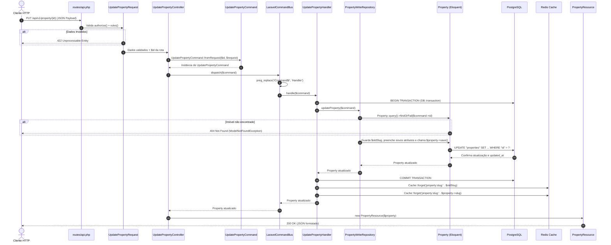

# Guia de Fluxo de Atualização de Imóvel (`UpdateProperty`) com CQRS (Da Requisição HTTP ao Save no Banco e Redis)

Este documento detalha o ciclo de vida completo da **atualização de um imóvel (`Property`)** aplicando o padrão **CQRS (Command Query Responsibility Segregation)** já estabelecido no projeto `homee.laravel`, cobrindo desde a requisição HTTP (`PUT`/`PATCH`), validação, transformação em `Command`, resolução automática pelo `LaravelCommandBus`, execução transacional no `Handler`, persistência via `PropertyWriteRepository` (`save()`), invalidação do cache Redis e retorno do `PropertyResource`.

> [!NOTE]
> Este guia segue os mesmos padrões arquiteturais implementados em [`CreatePropertyCommand`](file:///Users/hugolcouto/Projetos/homee/homee.laravel/app/Application/Users/Commands/CreateProperty/CreatePropertyCommand.php), [`CreatePropertyHandler`](file:///Users/hugolcouto/Projetos/homee/homee.laravel/app/Application/Users/Commands/CreateProperty/CreatePropertyHandler.php) e [`PropertyWriteRepository`](file:///Users/hugolcouto/Projetos/homee/homee.laravel/app/Infrastructure/Persistence/Eloquent/Write/PropertyWriteRepository.php).

---

## 1. Estrutura de Arquivos Envolvidos no Fluxo de Update

```text
app/
├── Shared/
│   └── CQRS/
│       ├── CommandInterface.php                                 # Contrato marcador de um Command
│       ├── CommandBusInterface.php                              # Contrato do barramento de escrita
│       └── LaravelCommandBus.php                                # Resolve UpdatePropertyCommand -> UpdatePropertyHandler
│
├── Domain/
│   ├── Properties/
│   │   └── Enums/
│   │       └── TransactionTypeEnum.php                          # Enum ('buy', 'rental')
│   └── Users/
│       └── Repositories/
│           └── PropertyWriteRepositoryInterface.php             # Contrato de escrita (createProperty, updateProperty)
│
├── Application/
│   └── Users/
│       └── Commands/
│           └── UpdateProperty/
│               ├── UpdatePropertyCommand.php                    # DTO imutável com dados de atualização e novo slug
│               └── UpdatePropertyHandler.php                    # Orquestra DB::transaction + invalidação do Redis
│
├── Infrastructure/
│   └── Persistence/
│       └── Eloquent/
│           └── Write/
│               └── PropertyWriteRepository.php                  # Busca o Property, aplica alterações e chama $property->save()
│
├── Http/
│   ├── Controllers/
│   │   └── Api/
│   │       └── V1/
│   │           └── Property/
│   │               └── UpdatePropertyController.php             # Single Action Controller (__invoke)
│   ├── Requests/
│   │   └── Api/
│   │       └── V1/
│   │           └── Property/
│   │               └── UpdatePropertyRequest.php                # Validação HTTP dos campos enviados
│   └── Resources/
│       └── Api/
│           └── V1/
│               └── PropertyResource.php                         # Formatação JSON de saída (valueInReal, etc.)
│
└── Models/
    └── Property.php                                             # Model Eloquent ($fillable e $casts)
```

---

## 2. Diagrama de Sequência: Do `PUT /api/v1/property/{id}` ao `save()` no Banco



---

## 3. Passo a Passo da Implementação

### Passo 1: Requisição HTTP (`PUT` ou `PATCH`)

O cliente envia uma requisição para atualizar um imóvel existente identificando-o pelo `{id}` (ou `{slug}`):

* **Endpoint:** `PUT /api/v1/property/{id}`
* **Headers:**
  * `Accept: application/json`
  * `Content-Type: application/json`
* **Payload (Body JSON):**
```json
{
  "title": "Cobertura Duplex Reformada",
  "valueInCents": 95000000,
  "description": "Cobertura duplex com vista panorâmica e área gourmet privativa.",
  "amenities": ["piscina", "churrasqueira", "ar-condicionado", "elevador"],
  "location": "Florianópolis, SC",
  "transactionType": "buy"
}
```

---

### Passo 2: Registro da Rota em [`routes/api.php`](file:///Users/hugolcouto/Projetos/homee/homee.laravel/routes/api.php)

No grupo `property` dentro de `routes/api.php`, adicione a rota `PUT` apontando para o Single Action Controller `UpdatePropertyController`:

```php
use App\Http\Controllers\Api\V1\Property\ListPropertiesController;
use App\Http\Controllers\Api\V1\Property\RegisterPropertyController;
use App\Http\Controllers\Api\V1\Property\ShowPropertyController;
use App\Http\Controllers\Api\V1\Property\UpdatePropertyController;
use Illuminate\Support\Facades\Route;

Route::prefix("property")->group(function () {
    Route::post('/create', RegisterPropertyController::class)->name('api.v1.properties.store');
    Route::put('/{id}', UpdatePropertyController::class)
        ->whereNumber('id')
        ->name('api.v1.properties.update');
    Route::get("/{slug}", ShowPropertyController::class)->name('api.v1.properties.getBySlug');
    Route::get("/", ListPropertiesController::class)->name('api.v1.properties.list');
});
```

---

### Passo 3: Validação da Entrada (`UpdatePropertyRequest`)

Seguindo o mesmo padrão do [`StorePropertyRequest`](file:///Users/hugolcouto/Projetos/homee/homee.laravel/app/Http/Requests/Api/V1/Property/StorePropertyRequest.php) e reutilizando a rule [`TransactionTypeRule`](file:///Users/hugolcouto/Projetos/homee/homee.laravel/app/Rules/TransactionTypeRule.php):

**Arquivo:** `app/Http/Requests/Api/V1/Property/UpdatePropertyRequest.php`

```php
<?php

namespace App\Http\Requests\Api\V1\Property;

use App\Rules\TransactionTypeRule;
use Illuminate\Contracts\Validation\ValidationRule;
use Illuminate\Foundation\Http\FormRequest;

class UpdatePropertyRequest extends FormRequest
{
    public function authorize(): bool
    {
        return true;
    }

    /**
     * @return array<string, ValidationRule|array<mixed>|string>
     */
    public function rules(): array
    {
        return [
            'title' => ['required', 'string', 'max:40'],
            'valueInCents' => ['required', 'integer', 'min:0'],
            'description' => ['required', 'string', 'max:255'],
            'amenities' => ['required', 'array'],
            'amenities.*' => ['required', 'string', 'max:255'],
            'location' => ['required', 'string', 'max:255'],
            'transactionType' => ['required', new TransactionTypeRule],
        ];
    }
}
```

---

### Passo 4: Construção do Command (`UpdatePropertyCommand`)

Seguindo o padrão de [`CreatePropertyCommand`](file:///Users/hugolcouto/Projetos/homee/homee.laravel/app/Application/Users/Commands/CreateProperty/CreatePropertyCommand.php), o `UpdatePropertyCommand` implementa [`CommandInterface`](file:///Users/hugolcouto/Projetos/homee/homee.laravel/app/Shared/CQRS/CommandInterface.php), recebe o `$id` do imóvel a ser alterado e já gera o novo `slug` a partir do `title` e converte `transactionType` para [`TransactionTypeEnum`](file:///Users/hugolcouto/Projetos/homee/homee.laravel/app/Domain/Properties/Enums/TransactionTypeEnum.php):

**Arquivo:** `app/Application/Users/Commands/UpdateProperty/UpdatePropertyCommand.php`

```php
<?php

namespace App\Application\Users\Commands\UpdateProperty;

use App\Domain\Properties\Enums\TransactionTypeEnum;
use App\Http\Requests\Api\V1\Property\UpdatePropertyRequest;
use App\Shared\CQRS\CommandInterface;
use Illuminate\Support\Str;

class UpdatePropertyCommand implements CommandInterface
{
    public function __construct(
        public int $id,
        public string $title,
        public string $slug,
        public int $valueInCents,
        public string $description,
        public array $amenities,
        public string $location,
        public TransactionTypeEnum $transactionType,
    ) {}

    public static function fromRequest(int $id, UpdatePropertyRequest $request): self
    {
        $validated = $request->validated();

        return new self(
            id: $id,
            title: $validated['title'],
            slug: Str::slug($validated['title'], '-', 'en'),
            valueInCents: $validated['valueInCents'],
            description: $validated['description'],
            amenities: $validated['amenities'],
            location: $validated['location'],
            transactionType: TransactionTypeEnum::from($validated['transactionType']),
        );
    }
}
```

---

### Passo 5: O Controller (`UpdatePropertyController`)

Assim como o [`RegisterPropertyController`](file:///Users/hugolcouto/Projetos/homee/homee.laravel/app/Http/Controllers/Api/V1/Property/RegisterPropertyController.php), o `UpdatePropertyController` apenas cria o `Command`, despacha para o [`CommandBusInterface`](file:///Users/hugolcouto/Projetos/homee/homee.laravel/app/Shared/CQRS/CommandBusInterface.php) e devolve o [`PropertyResource`](file:///Users/hugolcouto/Projetos/homee/homee.laravel/app/Http/Resources/Api/V1/PropertyResource.php) com status `200 OK`:

**Arquivo:** `app/Http/Controllers/Api/V1/Property/UpdatePropertyController.php`

```php
<?php

namespace App\Http\Controllers\Api\V1\Property;

use App\Application\Users\Commands\UpdateProperty\UpdatePropertyCommand;
use App\Http\Controllers\Controller;
use App\Http\Requests\Api\V1\Property\UpdatePropertyRequest;
use App\Http\Resources\Api\V1\PropertyResource;
use App\Shared\CQRS\CommandBusInterface;
use Illuminate\Http\JsonResponse;
use Illuminate\Http\Response;

class UpdatePropertyController extends Controller
{
    public function __invoke(
        int $id,
        UpdatePropertyRequest $request,
        CommandBusInterface $commandBus
    ): JsonResponse {
        $command = UpdatePropertyCommand::fromRequest($id, $request);

        $property = $commandBus->dispatch($command);

        return (new PropertyResource($property))
            ->response()
            ->setStatusCode(Response::HTTP_OK);
    }
}
```

---

### Passo 6: Resolução Automática pelo [`LaravelCommandBus`](file:///Users/hugolcouto/Projetos/homee/homee.laravel/app/Shared/CQRS/LaravelCommandBus.php)

Não é necessário registrar mapeamento manual para o novo Command. O [`LaravelCommandBus`](file:///Users/hugolcouto/Projetos/homee/homee.laravel/app/Shared/CQRS/LaravelCommandBus.php#L16-L26) executa:
```php
$handlerClass = preg_replace('/Command$/', 'Handler', $command::class);
```
Transformando automaticamente:
* `App\Application\Users\Commands\UpdateProperty\UpdatePropertyCommand`
* em `App\Application\Users\Commands\UpdateProperty\UpdatePropertyHandler`

---

### Passo 7: Execução Transacional e Invalidação do Cache (`UpdatePropertyHandler`)

O `UpdatePropertyHandler` segue o padrão do [`CreatePropertyHandler`](file:///Users/hugolcouto/Projetos/homee/homee.laravel/app/Application/Users/Commands/CreateProperty/CreatePropertyHandler.php), abrindo uma `DB::transaction()`. Além disso, como o `slug` pode mudar quando o `title` é alterado, ele invalida tanto o `slug` antigo quanto o novo no Redis:

**Arquivo:** `app/Application/Users/Commands/UpdateProperty/UpdatePropertyHandler.php`

```php
<?php

namespace App\Application\Users\Commands\UpdateProperty;

use App\Domain\Users\Repositories\PropertyWriteRepositoryInterface;
use App\Models\Property;
use Illuminate\Support\Facades\Cache;
use Illuminate\Support\Facades\DB;

class UpdatePropertyHandler
{
    public function __construct(
        private readonly PropertyWriteRepositoryInterface $propertyWriteRepository
    ) {}

    public function handle(UpdatePropertyCommand $command): Property
    {
        return DB::transaction(function () use ($command): Property {
            $property = $this->propertyWriteRepository->updateProperty($command);

            return $property;
        });
    }
}
```

> [!TIP]
> **Sincronização com Redis no Update:**
> Caso o cache por slug esteja ativo, você pode limpar a chave antiga antes/depois do `save()` no `UpdatePropertyHandler` ou no `PropertyWriteRepository`:
> ```php
> Cache::forget('property:slug:' . $oldSlug);
> Cache::forget('property:slug:' . $property->slug);
> ```

---

### Passo 8: Contrato e Persistência no Banco (`PropertyWriteRepository`)

#### 8.1. Atualizar o Contrato [`PropertyWriteRepositoryInterface.php`](file:///Users/hugolcouto/Projetos/homee/homee.laravel/app/Domain/Users/Repositories/PropertyWriteRepositoryInterface.php)

Adicione a assinatura do método `updateProperty`:

```php
<?php

namespace App\Domain\Users\Repositories;

use App\Application\Users\Commands\CreateProperty\CreatePropertyCommand;
use App\Application\Users\Commands\UpdateProperty\UpdatePropertyCommand;
use App\Models\Property;

interface PropertyWriteRepositoryInterface
{
    public function createProperty(CreatePropertyCommand $command): Property;

    public function updateProperty(UpdatePropertyCommand $command): Property;
}
```

#### 8.2. Implementar no [`PropertyWriteRepository.php`](file:///Users/hugolcouto/Projetos/homee/homee.laravel/app/Infrastructure/Persistence/Eloquent/Write/PropertyWriteRepository.php)

O repositório busca a entidade pelo ID (`findOrFail`), atualiza os atributos com `fill()`, executa `$property->save()` e invalida o cache do slug anterior:

```php
<?php

namespace App\Infrastructure\Persistence\Eloquent\Write;

use App\Application\Users\Commands\CreateProperty\CreatePropertyCommand;
use App\Application\Users\Commands\UpdateProperty\UpdatePropertyCommand;
use App\Domain\Users\Repositories\PropertyWriteRepositoryInterface;
use App\Models\Property;
use Illuminate\Support\Facades\Cache;

class PropertyWriteRepository implements PropertyWriteRepositoryInterface
{
    public function createProperty(CreatePropertyCommand $command): Property
    {
        $property = new Property([
            'title' => $command->title,
            'slug' => $command->slug,
            'valueInCents' => $command->valueInCents,
            'description' => $command->description,
            'amenities' => $command->amenities,
            'location' => $command->location,
            'transactionType' => $command->transactionType,
        ]);

        $property->save();

        return $property;
    }

    public function updateProperty(UpdatePropertyCommand $command): Property
    {
        $property = Property::query()->findOrFail($command->id);

        $oldSlug = $property->slug;

        $property->fill([
            'title' => $command->title,
            'slug' => $command->slug,
            'valueInCents' => $command->valueInCents,
            'description' => $command->description,
            'amenities' => $command->amenities,
            'location' => $command->location,
            'transactionType' => $command->transactionType,
        ]);

        $property->save();

        // Invalida o cache Redis do slug antigo e do novo
        Cache::forget('property:slug:' . $oldSlug);
        Cache::forget('property:slug:' . $property->slug);

        return $property;
    }
}
```

#### 8.3. O que acontece internamente no `$property->save()`
1. **Detecção de Dirty Attributes (`getDirty()`):** O Eloquent compara os valores atuais com os originais carregados no `findOrFail()` e monta o `UPDATE` apenas com as colunas que de fato mudaram.
2. **Casts Automáticos:** O array `$command->amenities` é serializado para JSON (`$casts = ['amenities' => 'array']` em [`Property.php`](file:///Users/hugolcouto/Projetos/homee/homee.laravel/app/Models/Property.php#L21-L23)) e o `TransactionTypeEnum` é convertido para seu valor em string (`'buy'` ou `'rental'`).
3. **Atualização do `updated_at`:** Caso haja ao menos uma coluna alterada, o Eloquent atualiza automaticamente o timestamp `updated_at`.
4. **Query SQL Executada no PostgreSQL:**
   ```sql
   UPDATE "properties"
   SET "title" = 'Cobertura Duplex Reformada',
       "slug" = 'cobertura-duplex-reformada',
       "valueInCents" = 95000000,
       "description" = 'Cobertura duplex com vista panorâmica e área gourmet privativa.',
       "amenities" = '["piscina","churrasqueira","ar-condicionado","elevador"]',
       "location" = 'Florianópolis, SC',
       "transactionType" = 'buy',
       "updated_at" = '2026-10-30 23:30:00'
   WHERE "id" = 1;
   ```

---

### Passo 9: Resposta HTTP Formatada pelo [`PropertyResource`](file:///Users/hugolcouto/Projetos/homee/homee.laravel/app/Http/Resources/Api/V1/PropertyResource.php)

O `UpdatePropertyController` retorna o `PropertyResource` com status `200 OK`:

```json
{
  "data": {
    "id": 1,
    "title": "Cobertura Duplex Reformada",
    "slug": "cobertura-duplex-reformada",
    "valueInReal": 950000,
    "description": "Cobertura duplex com vista panorâmica e área gourmet privativa.",
    "amenities": [
      "piscina",
      "churrasqueira",
      "ar-condicionado",
      "elevador"
    ],
    "location": "Florianópolis, SC",
    "transactionType": "buy"
  }
}
```
