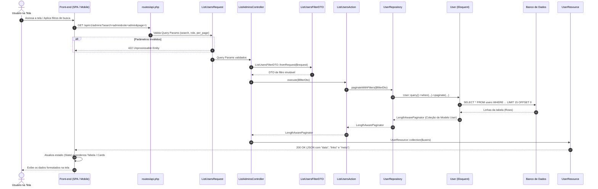

# Guia de Consulta e Leitura de Dados (Do GET na Rota até a Visualização na Tela)

Este documento dá continuidade ao guia de [Arquitetura e Fluxo de Cadastro de Admin](file:///Users/hugolcouto/Projetos/homee/homee.laravel/.docs/arquitetura-e-fluxo-cadastro-admin.md), detalhando o fluxo inverso: **a busca e recuperação de dados do banco de dados (`GET`)**, passando por todas as camadas da Arquitetura Limpa no Laravel 12 até a entrega do JSON e a renderização na tela pelo Front-end.

---

## 1. Cenários de Busca em uma API REST

Em um sistema imobiliário (tanto para **Usuários/Admins** quanto para **Imóveis de Venda e Aluguel**), existem dois padrões principais de busca:

1. **Listagem com Filtros e Paginação (`GET /api/v1/admins` ou `GET /api/v1/properties`)**:
   - Recebe parâmetros via *Query String* (`?search=hugo&role=admin&page=1&per_page=15`).
   - Retorna uma lista paginada de registros com metadados de paginação (`meta` e `links`).
2. **Busca de Registro Único / Detalhe (`GET /api/v1/admins/{id}`)**:
   - Recebe o identificador na própria URL (*Route Parameter*).
   - Retorna um único objeto detalhado ou erro `404 Not Found` caso não exista.

---

## 2. Arquitetura dos Componentes de Leitura (Query Flow)

Seguindo a mesma estrutura limpa definida anteriormente, adicionamos os componentes voltados para consulta:

```text
app/
├── Domain/
│   └── Users/
│       ├── DTOs/
│       │   └── ListUsersFilterDTO.php        # Transporta os filtros validados da Query String
│       └── Repositories/
│           └── UserRepositoryInterface.php   # Contratos findById() e paginateWithFilters()
│
├── Application/
│   └── Users/
│       └── Actions/ (ou Queries/)
│           ├── ListUsersAction.php           # Caso de uso de listagem paginada
│           └── GetUserByIdAction.php         # Caso de uso de busca por ID
│
├── Infrastructure/
│   └── Persistence/
│       └── Eloquent/
│           └── UserRepository.php            # Queries Eloquent otimizadas
│
└── Http/
    ├── Controllers/
    │   └── Api/
    │       └── V1/
    │           └── Admin/
    │               ├── ListAdminsController.php
    │               └── ShowAdminController.php
    ├── Requests/
    │   └── Api/
    │       └── V1/
    │           └── Admin/
    │               └── ListUsersRequest.php  # Valida os parâmetros da URL (Query Params)
    └── Resources/
        └── Api/
            └── V1/
                └── UserResource.php          # Formata tanto um item único quanto uma coleção
```

---

## 3. Fluxo Completo da Busca (Diagrama de Sequência)

O diagrama abaixo demonstra o caminho completo desde a ação do usuário na tela do Front-end até a consulta SQL no banco de dados e a renderização visual dos dados:



---

## 4. Passo a Passo: Da Requisição da Rota até a Visualização na Tela

Abaixo detalhamos cada etapa cobrindo **tanto a listagem filtrada/paginada** quanto a **visualização de um registro específico**.

---

### Passo 1: Disparo da Requisição pelo Front-end

Quando o usuário abre a tela de listagem de administradores (ou imóveis) ou digita no campo de busca, o Front-end faz uma chamada HTTP `GET` enviando os filtros na *Query String*:

- **Busca Paginada**:
  `GET /api/v1/admins?search=Administrador&role=admin&per_page=10&page=1`
- **Busca por ID (Detalhe)**:
  `GET /api/v1/admins/1`
- **Headers**:
  - `Accept: application/json`
  - `Authorization: Bearer {token}` (para rotas autenticadas)

---

### Passo 2: Registro das Rotas (`routes/api.php`)

As rotas `GET` são mapeadas para seus respectivos Single Action Controllers:

```php
<?php

use App\Http\Controllers\Api\V1\Admin\ListAdminsController;
use App\Http\Controllers\Api\V1\Admin\RegisterAdminController;
use App\Http\Controllers\Api\V1\Admin\ShowAdminController;
use Illuminate\Support\Facades\Route;

Route::prefix('v1')->group(function () {
    Route::post('/admins', RegisterAdminController::class)->name('api.v1.admins.store');

    // Rotas de Busca (Leitura)
    Route::get('/admins', ListAdminsController::class)->name('api.v1.admins.index');
    Route::get('/admins/{id}', ShowAdminController::class)
        ->whereNumber('id')
        ->name('api.v1.admins.show');
});
```

---

### Passo 3: Validação dos Parâmetros de Busca (`FormRequest`)

Mesmo em requisições `GET`, é uma excelente prática validar os parâmetros de filtro e paginação. Isso evita que o cliente envie `per_page=1000000` (derrubando o banco de dados) ou valores inválidos de `role`.

**Arquivo**: `app/Http/Requests/Api/V1/Admin/ListUsersRequest.php`

```php
<?php

namespace App\Http\Requests\Api\V1\Admin;

use App\Domain\Users\Enums\UserRoleEnum;
use Illuminate\Foundation\Http\FormRequest;
use Illuminate\Validation\Rule;

class ListUsersRequest extends FormRequest
{
    public function authorize(): bool
    {
        return true; // Ou verificação de Policy/Gate (ex: $this->user()?->isAdmin())
    }

    public function rules(): array
    {
        return [
            'search' => ['nullable', 'string', 'max:100'],
            'role' => ['nullable', 'string', Rule::in(array_column(UserRoleEnum::cases(), 'value'))],
            'per_page' => ['nullable', 'integer', 'min:1', 'max:100'],
            'page' => ['nullable', 'integer', 'min:1'],
            'sort_by' => ['nullable', 'string', Rule::in(['id', 'name', 'email', 'created_at'])],
            'sort_dir' => ['nullable', 'string', Rule::in(['asc', 'desc'])],
        ];
    }
}
```

---

### Passo 4: Construção do DTO de Filtro (`ListUsersFilterDTO`)

Transformamos os parâmetros opcionais da URL em um objeto tipado com valores padrão seguros (ex: `perPage = 15`, ordenação por `created_at desc`).

**Arquivo**: `app/Domain/Users/DTOs/ListUsersFilterDTO.php`

```php
<?php

namespace App\Domain\Users\DTOs;

use App\Domain\Users\Enums\UserRoleEnum;
use App\Http\Requests\Api\V1\Admin\ListUsersRequest;

readonly class ListUsersFilterDTO
{
    public function __construct(
        public ?string $search = null,
        public ?UserRoleEnum $role = null,
        public int $perPage = 15,
        public string $sortBy = 'created_at',
        public string $sortDir = 'desc',
    ) {}

    public static function fromRequest(ListUsersRequest $request): self
    {
        $validated = $request->validated();

        return new self(
            search: $validated['search'] ?? null,
            role: isset($validated['role'])
                ? UserRoleEnum::from($validated['role'])
                : UserRoleEnum::ADMIN, // Padrão para o endpoint de admins
            perPage: (int) ($validated['per_page'] ?? 15),
            sortBy: $validated['sort_by'] ?? 'created_at',
            sortDir: $validated['sort_dir'] ?? 'desc',
        );
    }
}
```

---

### Passo 5: Recebimento nos Controllers (`List` e `Show`)

#### 5.1. Controller de Listagem (`app/Http/Controllers/Api/V1/Admin/ListAdminsController.php`)
```php
<?php

namespace App\Http\Controllers\Api\V1\Admin;

use App\Application\Users\Actions\ListUsersAction;
use App\Domain\Users\DTOs\ListUsersFilterDTO;
use App\Http\Controllers\Controller;
use App\Http\Requests\Api\V1\Admin\ListUsersRequest;
use App\Http\Resources\Api\V1\UserResource;
use Illuminate\Http\Resources\Json\AnonymousResourceCollection;

class ListAdminsController extends Controller
{
    public function __invoke(
        ListUsersRequest $request,
        ListUsersAction $listUsersAction
    ): AnonymousResourceCollection {
        // 1. Converte os filtros da URL em DTO
        $filterDto = ListUsersFilterDTO::fromRequest($request);

        // 2. Executa a busca paginada via Action
        $users = $listUsersAction->execute($filterDto);

        // 3. Retorna a coleção envelopada pelo UserResource (inclui meta e links de paginação)
        return UserResource::collection($users);
    }
}
```

#### 5.2. Controller de Detalhe por ID (`app/Http/Controllers/Api/V1/Admin/ShowAdminController.php`)
```php
<?php

namespace App\Http\Controllers\Api\V1\Admin;

use App\Application\Users\Actions\GetUserByIdAction;
use App\Http\Controllers\Controller;
use App\Http\Resources\Api\V1\UserResource;

class ShowAdminController extends Controller
{
    public function __invoke(
        int $id,
        GetUserByIdAction $getUserByIdAction
    ): UserResource {
        // Busca o usuário ou lança ModelNotFoundException (que o Laravel converte em 404 JSON)
        $user = $getUserByIdAction->execute($id);

        return new UserResource($user);
    }
}
```

---

### Passo 6: Camada de Aplicação (`Actions` de Leitura)

As Actions orquestram a chamada ao repositório (e, caso necessário no futuro, podem aplicar cache como `Cache::remember(...)` sem sujar o Controller ou o Repositório).

#### 6.1. `ListUsersAction` (`app/Application/Users/Actions/ListUsersAction.php`)
```php
<?php

namespace App\Application\Users\Actions;

use App\Domain\Users\DTOs\ListUsersFilterDTO;
use App\Domain\Users\Repositories\UserRepositoryInterface;
use Illuminate\Contracts\Pagination\LengthAwarePaginator;

class ListUsersAction
{
    public function __construct(
        private readonly UserRepositoryInterface $userRepository
    ) {}

    public function execute(ListUsersFilterDTO $filterDto): LengthAwarePaginator
    {
        return $this->userRepository->paginateWithFilters($filterDto);
    }
}
```

#### 6.2. `GetUserByIdAction` (`app/Application/Users/Actions/GetUserByIdAction.php`)
```php
<?php

namespace App\Application\Users\Actions;

use App\Domain\Users\Repositories\UserRepositoryInterface;
use App\Models\User;
use Illuminate\Database\Eloquent\ModelNotFoundException;

class GetUserByIdAction
{
    public function __construct(
        private readonly UserRepositoryInterface $userRepository
    ) {}

    public function execute(int $id): User
    {
        $user = $this->userRepository->findById($id);

        if (! $user) {
            throw (new ModelNotFoundException())->setModel(User::class, [$id]);
        }

        return $user;
    }
}
```

---

### Passo 7: Consulta no Banco de Dados (`Repository` e `Eloquent`)

Aqui o Eloquent monta a query SQL dinâmica utilizando o método `when()`, aplicando apenas os filtros que foram preenchidos pelo usuário, e hidrata os resultados em objetos [`User`](file:///Users/hugolcouto/Projetos/homee/homee.laravel/app/Models/User.php).

#### 7.1. Atualização do Contrato (`app/Domain/Users/Repositories/UserRepositoryInterface.php`)
```php
<?php

namespace App\Domain\Users\Repositories;

use App\Domain\Users\DTOs\CreateAdminDTO;
use App\Domain\Users\DTOs\ListUsersFilterDTO;
use App\Models\User;
use Illuminate\Contracts\Pagination\LengthAwarePaginator;

interface UserRepositoryInterface
{
    public function createAdmin(CreateAdminDTO $dto): User;

    public function findById(int $id): ?User;

    public function paginateWithFilters(ListUsersFilterDTO $filterDto): LengthAwarePaginator;
}
```

#### 7.2. Implementação das Queries (`app/Infrastructure/Persistence/Eloquent/UserRepository.php`)
```php
<?php

namespace App\Infrastructure\Persistence\Eloquent;

use App\Domain\Users\DTOs\CreateAdminDTO;
use App\Domain\Users\DTOs\ListUsersFilterDTO;
use App\Domain\Users\Repositories\UserRepositoryInterface;
use App\Models\User;
use Illuminate\Contracts\Pagination\LengthAwarePaginator;
use Illuminate\Database\Eloquent\Builder;

class UserRepository implements UserRepositoryInterface
{
    public function createAdmin(CreateAdminDTO $dto): User
    {
        return User::create([
            'name' => $dto->name,
            'email' => $dto->email,
            'password' => $dto->password,
            'role' => $dto->role,
        ]);
    }

    public function findById(int $id): ?User
    {
        // Executa: SELECT * FROM users WHERE id = ? LIMIT 1
        return User::query()->find($id);
    }

    public function paginateWithFilters(ListUsersFilterDTO $filterDto): LengthAwarePaginator
    {
        return User::query()
            // Filtra por role (ex: 'admin') se informado
            ->when($filterDto->role, function (Builder $query, $role) {
                $query->where('role', $role->value);
            })
            // Filtra por termo de busca (nome ou e-mail) agrupado entre parênteses no SQL
            ->when($filterDto->search, function (Builder $query, string $search) {
                $query->where(function (Builder $subQuery) use ($search) {
                    $subQuery->where('name', 'like', "%{$search}%")
                             ->orWhere('email', 'like', "%{$search}%");
                });
            })
            // Ordenação segura (já validada no FormRequest)
            ->orderBy($filterDto->sortBy, $filterDto->sortDir)
            // Executa 2 queries: COUNT(*) para o total e SELECT com LIMIT/OFFSET
            ->paginate($filterDto->perPage);
    }
}
```

---

### Passo 8: Transformação em JSON (`UserResource`)

O mesmo `UserResource` criado para o `POST` é reutilizado aqui:
- Quando usado com `new UserResource($user)` (no `ShowAdminController`), ele formata **um único objeto**.
- Quando usado com `UserResource::collection($users)` (no `ListAdminsController`), o Laravel detecta automaticamente que `$users` é um `LengthAwarePaginator` e gera os blocos `data`, `links` e `meta`.

#### Exemplo do JSON Retornado na Listagem (`200 OK`):
```json
{
  "data": [
    {
      "id": 1,
      "name": "Administrador Principal",
      "email": "admin@homee.com.br",
      "role": "admin",
      "created_at": "2026-10-21T14:47:37+00:00"
    }
  ],
  "links": {
    "first": "http://localhost:8000/api/v1/admins?page=1",
    "last": "http://localhost:8000/api/v1/admins?page=1",
    "prev": null,
    "next": null
  },
  "meta": {
    "current_page": 1,
    "from": 1,
    "last_page": 1,
    "per_page": 10,
    "to": 1,
    "total": 1
  }
}
```

---

### Passo 9: Recebimento e Visualização dos Dados na Tela (Front-end)

Quando a resposta `200 OK` chega ao navegador ou aplicativo mobile, o ciclo se completa na camada de visualização (UI):

1. **Consumo da API (Fetch / Axios / TanStack Query)**:
   O cliente HTTP no Front-end recebe o payload JSON e separa `response.data` (a lista de administradores) e `response.meta` (dados de paginação).
2. **Gerenciamento de Estado (State)**:
   - `isLoading` passa de `true` para `false` (ocultando o *skeleton* ou *spinner* de carregamento).
   - O array `data` preenche o estado da lista.
3. **Renderização na Interface**:
   - **Tabela / Lista de Cards**: Cada item de `data` é iterado (`.map()`) exibindo `name`, `email`, uma *badge* visual para `role` (`admin`) e a data `created_at` formatada para o fuso local (`dd/mm/aaaa`).
   - **Componente de Paginação**: Lê `meta.current_page`, `meta.last_page` e `meta.total` para desenhar os botões "Anterior / Próximo" e o contador *"Exibindo 1 de 1 registros"*.
   - **Tratamento de Estado Vazio (Empty State)**: Caso `data` retorne `[]` (`meta.total === 0`), a tela exibe uma mensagem amigável (*"Nenhum administrador encontrado para os filtros aplicados"*).

#### Exemplo Conceitual de Consumo e Exibição no Front-end:
```javascript
async function fetchAdmins( { search = '', page = 1 } = {} ) {
  const params = new URLSearchParams({
    search,
    role: 'admin',
    page: String(page),
    per_page: '10',
  });

  const response = await fetch(`/api/v1/admins?${params.toString()}`, {
    headers: {
      'Accept': 'application/json',
      'Authorization': `Bearer ${localStorage.getItem('access_token')}`,
    },
  });

  if (!response.ok) {
    throw new Error('Erro ao carregar os administradores');
  }

  // Retorna { data: [...], links: {...}, meta: {...} }
  return await response.json();
}
```

---

## 5. Aplicando o Mesmo Padrão na Busca de Imóveis (Venda e Aluguel)

Para a vitrine e busca de imóveis do sistema (`GET /api/v1/properties`), esse mesmo fluxo suporta filtros ricos de forma organizada:

- **Query String na Tela de Busca de Imóveis**:
  `GET /api/v1/properties?transaction_type=rent&city=Sao+Paulo&min_price=2000&max_price=5000&bedrooms=2&page=1`
- **`ListPropertiesRequest`**: Valida se `min_price <= max_price`, se `transaction_type` é `sale` ou `rent`, etc.
- **`ListPropertiesFilterDTO`**: Encapsula todos os filtros de imóveis com tipos estritos (`?TransactionTypeEnum $transactionType`, `?int $bedrooms`, `?float $minPrice`).
- **`PropertyRepository::paginateWithFilters()`**:
  - Usa `with(['photos', 'address', 'broker'])` (*Eager Loading*) para evitar o problema de performance **N+1 Queries** ao carregar as fotos e endereço de cada imóvel.
  - Aplica os filtros com `->when(...)`.
- **`PropertyResource`**: Formata os valores monetários, endereço resumido e lista de URLs das imagens para exibição imediata nos cards de imóveis na tela.
