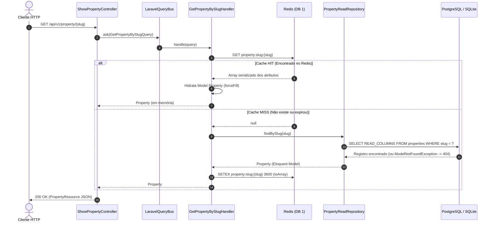
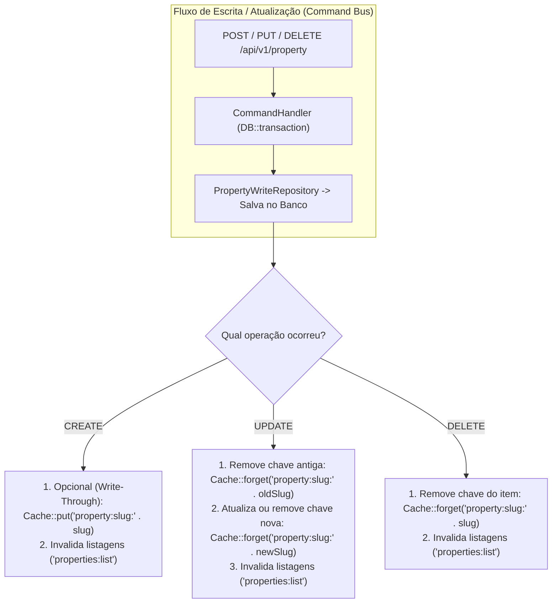

# Arquitetura e Implementação de Cache Redis no Domínio de Imóveis (`Property`)

**Data da Análise:** 30/10/2026  
**Escopo:** Fluxos de Leitura (*Read*), Gravação (*Write*) e Atualização/Invalidação (*Update/Eviction*) com Redis no projeto `homee.laravel`.

---

## 1. Visão Geral e Objetivo

O domínio de imóveis (`Property`) possui operações de leitura intensiva:
1. **Busca individual por slug:** `GET /api/v1/property/{slug}`
2. **Listagem com filtros dinâmicos e paginação:** `GET /api/v1/property`

O objetivo da camada de cache em **Redis** é reduzir a latência dessas respostas e aliviar a carga de consultas repetitivas no banco de dados relacional (PostgreSQL/SQLite), especialmente em filtros combinados (`ilike`, `whereJsonContains` na coluna JSON `amenities` e paginação), mantendo a arquitetura **CQRS** do projeto desacoplada da infraestrutura de persistência.

---

## 2. Mapeamento dos Arquivos do Projeto

| Camada | Arquivo | Papel no Fluxo |
| :--- | :--- | :--- |
| **Configuração** | `config/cache.php` | Define o store padrão (`CACHE_STORE`), prefixo de chaves (`CACHE_PREFIX`) e o driver `redis`. |
| **Configuração** | `config/database.php` | Define as conexões Redis: `default` (DB `0`) e `cache` (DB `1`), usando `phpredis`. |
| **Http (Controller)** | `app/Http/Controllers/Api/V1/Property/ShowPropertyController.php` | Recebe o `{slug}`, despacha `GetPropertyBySlugQuery` via `QueryBusInterface` e retorna `PropertyResource`. |
| **Http (Controller)** | `app/Http/Controllers/Api/V1/Property/ListPropertiesController.php` | Recebe filtros via `ListPropertiesRequest`, aplica cache e pagina os resultados. |
| **Http (Controller)** | `app/Http/Controllers/Api/V1/Property/RegisterPropertyController.php` | Recebe `StorePropertyRequest`, despacha `CreatePropertyCommand` via `CommandBusInterface`. |
| **Http (Resource)** | `app/Http/Resources/Api/V1/PropertyResource.php` | Transforma o model `Property` em JSON (converte `valueInCents` em `valueInReal`). |
| **Application (Query)** | `app/Application/Users/Queries/GetPropertyBySlug/GetPropertyBySlugHandler.php` | Orquestra a leitura no Redis (`Cache::get`) e o fallback/gravação a partir do `PropertyReadRepositoryInterface`. |
| **Application (Query)** | `app/Application/Users/Queries/ListProperties/ListPropertiesHandler.php` | Handler CQRS para listagem paginada via `PropertyReadRepositoryInterface`. |
| **Application (Command)** | `app/Application/Users/Commands/CreateProperty/CreatePropertyHandler.php` | Executa a criação do imóvel em transação (`DB::transaction`) via `PropertyWriteRepositoryInterface`. |
| **Infrastructure (Read)** | `app/Infrastructure/Persistence/Eloquent/Read/PropertyReadRepository.php` | Consulta otimizada no Eloquent selecionando apenas `READ_COLUMNS`. |
| **Infrastructure (Write)** | `app/Infrastructure/Persistence/Eloquent/Write/PropertyWriteRepository.php` | Persiste a entidade `Property` no banco de dados. |
| **Domain / Model** | `app/Models/Property.php` | Model Eloquent com `$fillable` e `$casts = ['amenities' => 'array']`. |

---

## 3. Diagnóstico da Implementação Atual no Projeto

Durante a análise estática do código atual, foram identificados **3 pontos críticos** na implementação existente que impactam o funcionamento real do cache:

### 3.1. `GetPropertyBySlugHandler.php` — Perda do campo `id` ao hidratar do Cache
No arquivo `app/Application/Users/Queries/GetPropertyBySlug/GetPropertyBySlugHandler.php`:
```php
$cacheKey = 'property:slug' . $query->slug; // Falta ':' separador após 'slug'
$cached = Cache::get($cacheKey);

if ($cached) return new Property($cached);
```
* **O que acontece:** O construtor `new Property($cached)` utiliza internamente o método `fill()`, que **ignora qualquer atributo fora da propriedade `$fillable`** do Model (`app/Models/Property.php`).
* **Impacto:** Como `id` e `created_at` não estão em `$fillable`, quando ocorre **Cache Hit**, o objeto `Property` retornado terá `$property->id === null`. Consequentemente, o `PropertyResource` retornará `"id": null` no JSON a partir da segunda requisição.
* **Correção recomendada:** Hidratar o Model usando `(new Property())->forceFill($cached)`, garantindo que `id`, `created_at` e os casts (como o array `amenities`) sejam preservados mesmo fora de `$fillable`.

### 3.2. `ListPropertiesController.php` — Cache executado antes dos filtros e resultado descartado
No arquivo `app/Http/Controllers/Api/V1/Property/ListPropertiesController.php` (linhas 20–65):
```php
$query = Property::query();

$cacheKey = "properties:list" . md5(http_build_query($request->all()));

$cached = Cache::remember($cacheKey, 300, function () use ($query, $request) {
    return $query->paginate($request->per_page ?? 10);
});

// Os filtros (search, title, valueInCents, transactionType, amenities) estão ABAIXO do Cache::remember
// ...
$properties = $query->paginate($perPage);
return response()->json($properties);
```
* **O que acontece:**
  1. O `Cache::remember` é chamado **antes** de adicionar as cláusulas `where` (`search`, `title`, `valueInCents`, `transactionType`, `amenities`) e `orderBy` na `$query`.
  2. O valor armazenado na variável `$cached` **nunca é retornado** pelo controller; no final do método, `$query->paginate($perPage)` é executado novamente no banco de dados.
* **Impacto:** Toda requisição executa a query no banco de dados (e na primeira vez que uma chave expira, executa **duas** queries: uma sem filtros dentro do `Cache::remember` e outra com filtros no final).
* **Correção recomendada:** Montar todas as cláusulas da `$query` primeiro (ou delegar ao `ListPropertiesHandler`) e executar o `Cache::remember()` apenas no momento do `paginate()`, retornando o resultado cacheado.

### 3.3. `.env.example` — Driver padrão ainda definido como `database`
No `.env.example`, a variável `CACHE_STORE=database` faz com que o Laravel utilize a tabela SQL `cache` por padrão, a menos que seja alterada para `CACHE_STORE=redis` no `.env`.

---

## 4. Configuração da Infraestrutura Redis no Laravel

O projeto já possui a estrutura de configuração pronta em `config/database.php` e `config/cache.php`:

1. **Isolamento de Databases Lógicos (`config/database.php`):**
   * Conexão `default`: utiliza `REDIS_DB=0` (para filas, sessões ou comandos diretos).
   * Conexão `cache`: utiliza `REDIS_CACHE_DB=1` (exclusiva para o store `redis` definido em `config/cache.php`). Isso evita que um `Cache::flush()` apague filas ou sessões.
2. **Prefixos Automáticos:**
   * Prefixo da conexão Redis: `{app_name}-database-`
   * Prefixo do Cache (`config/cache.php`): `{app_name}-cache-`
   * Uma chave chamada `'property:slug:casa-praia'` é gravada no Redis fisicamente como:
     `laravel-database-laravel-cache-property:slug:casa-praia`

### Variáveis necessárias no `.env`
```env
CACHE_STORE=redis
CACHE_PREFIX=homee-cache-

REDIS_CLIENT=phpredis
REDIS_HOST=127.0.0.1
REDIS_PASSWORD=null
REDIS_PORT=6379
REDIS_DB=0
REDIS_CACHE_DB=1
```

---

## 5. Fluxo de Leitura e Gravação em Cache (Padrão *Cache-Aside*)

O projeto adota o padrão **Cache-Aside (Lazy Loading)** para leituras: a aplicação consulta primeiro o Redis; se encontrar (**Cache Hit**), retorna imediatamente sem tocar no banco. Se não encontrar (**Cache Miss**), consulta o banco de dados, **grava o resultado no Redis** com um TTL definido e retorna ao cliente.



---

### 5.1. Detalhamento: Busca Individual por Slug (`GetPropertyBySlug`)

#### A. Fluxo de Leitura (*Cache Hit*)
1. O `ShowPropertyController` recebe o `$slug` da rota e envia `GetPropertyBySlugQuery` para o `QueryBusInterface`.
2. O `GetPropertyBySlugHandler` monta a chave determinística: `property:slug:{slug}`.
3. O comando `Cache::get($cacheKey)` faz um `GET` no Redis:
   * Se a chave existir, o driver `phpredis` desserializa o payload de volta para um `array` associativo do PHP (com `amenities` já estruturado como array).
   * O Handler reconstrói a instância do `Property` sem consultar o banco.

#### B. Fluxo de Gravação no Cache (*Cache Miss*)
1. Quando `Cache::get($cacheKey)` retorna `null`, o Handler aciona `$this->propertyReadRepository->findBySlug($query->slug)`.
2. O `PropertyReadRepository` executa:
   ```php
   Property::query()
       ->select(self::READ_COLUMNS)
       ->where('slug', $slug)
       ->firstOrFail();
   ```
   > **Importante:** Como o repositório usa `firstOrFail()`, caso o `slug` não exista no banco, uma `ModelNotFoundException` é lançada **antes** da linha `Cache::put()`. Isso garante que **resultados inexistentes (404) nunca sejam gravados indevidamente no Redis** com TTL longo.
3. Com o Model retornado do banco, `$property->toArray()` converte os atributos selecionados em array (respeitando `$casts = ['amenities' => 'array']`).
4. `Cache::put($cacheKey, $property->toArray(), 3600)` executa um `SETEX` no Redis com **TTL de 3600 segundos (1 hora)**.

#### Implementação Recomendada para o `GetPropertyBySlugHandler`
```php
<?php

namespace App\Application\Users\Queries\GetPropertyBySlug;

use App\Domain\Users\Repositories\PropertyReadRepositoryInterface;
use App\Models\Property;
use Illuminate\Support\Facades\Cache;

class GetPropertyBySlugHandler
{
    private const CACHE_TTL_SECONDS = 3600; // 1 hora

    public function __construct(
        private readonly PropertyReadRepositoryInterface $propertyReadRepository
    ) {}

    public function handle(GetPropertyBySlugQuery $query): Property
    {
        $cacheKey = 'property:slug:' . $query->slug;

        $cached = Cache::get($cacheKey);

        if (is_array($cached)) {
            // forceFill preserva 'id' e 'created_at' (mesmo fora de $fillable) e aceita 'amenities' já como array
            return (new Property())->forceFill($cached);
        }

        $property = $this->propertyReadRepository->findBySlug($query->slug);

        Cache::put($cacheKey, $property->toArray(), self::CACHE_TTL_SECONDS);

        return $property;
    }
}
```

---

### 5.2. Detalhamento: Listagem e Filtros (`ListProperties`)

Na rota `GET /api/v1/property`, a consulta depende de múltiplos parâmetros de query string validados pelo `ListPropertiesRequest`:
`search`, `title`, `valueInCents`, `transactionType`, `amenities[]`, `sort_by`, `sort_dir`, `per_page` e `page`.

#### A. Construção e Normalização da Chave de Cache
Se dois usuários enviarem os mesmos filtros em ordem diferente na URL (ex: `?page=1&transactionType=buy` vs `?transactionType=buy&page=1`), `http_build_query($request->all())` geraria strings diferentes e duas entradas duplicadas no Redis.
Para evitar fragmentação do cache:
1. Utilize apenas os parâmetros validados (`$request->validated()`).
2. Ordene as chaves do array recursivamente (`ksort`) antes de gerar o hash `md5`.

#### B. Fluxo de Leitura e Gravação com `Cache::remember`
Diferente da busca por slug (TTL de 1 hora), listagens filtradas usam um **TTL mais curto (300 segundos / 5 minutos)**, pois refletem coleções que mudam com novos cadastros.

```php
// 1. Normalização dos parâmetros para gerar um hash único e consistente
$filters = $request->validated();
ksort($filters);
if (isset($filters['amenities']) && is_array($filters['amenities'])) {
    sort($filters['amenities']);
}

$cacheKey = 'properties:list:' . md5(http_build_query($filters));

// 2. Construção da Query completa e execução dentro do Cache::remember
$properties = Cache::remember($cacheKey, 300, function () use ($request) {
    $query = Property::query();

    if ($request->filled('search')) {
        $search = $request->search;
        $query->where(function ($q) use ($search) {
            $q->where('title', 'ilike', '%' . $search . '%')
              ->orWhere('location', 'ilike', '%' . $search . '%');
        });
    }

    if ($request->filled('title')) {
        $query->where('title', 'ilike', '%' . $request->title . '%');
    }

    if ($request->filled('valueInCents')) {
        $query->where('valueInCents', $request->valueInCents);
    }

    if ($request->filled('transactionType')) {
        $query->where('transactionType', $request->transactionType);
    } elseif ($request->has('transactionType') && $request->transactionType === null) {
        $query->whereIn('transactionType', [TransactionTypeEnum::BUY, TransactionTypeEnum::RENTAL]);
    }

    if ($request->filled('amenities')) {
        foreach ((array) $request->amenities as $amenity) {
            $query->whereJsonContains('amenities', $amenity);
        }
    }

    $sortBy = $request->input('sort_by', 'created_at');
    $sortDir = $request->input('sort_dir', 'desc');
    $query->orderBy($sortBy, $sortDir);

    $perPage = (int) $request->input('per_page', 15);

    return $query->paginate($perPage);
});

return response()->json($properties);
```

---

## 6. Fluxo de Gravação no Banco de Dados e Sincronização com Redis (`CreateProperty`, `Update`, `Delete`)

Quando um imóvel é **criado**, **atualizado** ou **removido** no banco de dados (fluxo de *Write* via Command Bus), o cache no Redis precisa reagir para evitar **Stale Data** (dados defasados sendo servidos pela API).



### 6.1. Criação de Imóvel (`CreatePropertyHandler`)
Atualmente, o `CreatePropertyHandler` (`app/Application/Users/Commands/CreateProperty/CreatePropertyHandler.php`) persiste o imóvel dentro de `DB::transaction()`.
Após o commit no banco, existem duas ações complementares em relação ao Redis:
1. **Cache Warming / Write-Through (Opcional):** Gravar imediatamente `property:slug:{slug}` no Redis para que o primeiro acesso à página recém-criada já seja um *Cache Hit*.
2. **Invalidação das Listagens:** Como um novo imóvel entrou no catálogo, a primeira página de `GET /api/v1/property` (ordenada por `created_at desc`) mudou. As chaves de listagem precisam ser invalidadas.

### 6.2. Atualização de Imóvel (Update no Banco de Dados)
Quando um registro `Property` sofre `UPDATE` no banco de dados (ex: mudança de preço `valueInCents`, `amenities` ou `title`/`slug`):
* **Cenário A — Os dados mudaram, mas o `slug` permaneceu igual:**
  * Podemos **invalidar** a chave (`Cache::forget('property:slug:' . $property->slug)`) para que a próxima leitura busque os dados frescos do banco, **ou** atualizar o valor diretamente (`Cache::put(...)`). A invalidação (`forget`) é mais segura contra *race conditions* de escritas concorrentes.
* **Cenário B — O `title` mudou e gerou um novo `slug`:**
  * É obrigatório remover a chave do **slug antigo** (`$property->getOriginal('slug')`), caso contrário o endereço antigo continuaria respondendo `200 OK` no Redis até expirar os 60 minutos de TTL!

### 6.3. Estratégias para Invalidar as Listagens Paginadas (`properties:list:*`)

Como as chaves de listagem usam hash dos filtros (`properties:list:{md5}`), não sabemos de antemão todos os hashes gerados pelos usuários. Existem duas abordagens no Laravel com Redis:

#### Abordagem 1: Usando `Cache::tags` (Nativa do Driver Redis no Laravel)
O driver `redis` do Laravel suporta **Cache Tags** nativamente:
* **Na leitura/gravação da listagem (`ListProperties`):**
  ```php
  $properties = Cache::tags(['properties:list'])->remember($cacheKey, 300, function () {
      // query->paginate(...)
  });
  ```
* **No momento do Create / Update / Delete:**
  ```php
  Cache::tags(['properties:list'])->flush();
  ```
  Isso limpa instantaneamente todas as combinações de filtros paginados sem afetar o cache individual por slug (`property:slug:*`) nem outros domínios (`Admin`, `Customer`).

#### Abordagem 2: Centralização via Eloquent Observer (`PropertyObserver`)
Para manter os Handlers CQRS limpos e garantir que **qualquer** alteração no model `Property` (seja via Command Handler, Job ou Tinker) sincronize o Redis automaticamente, pode-se registrar um Observer:

```php
<?php

namespace App\Observers;

use App\Models\Property;
use Illuminate\Support\Facades\Cache;

class PropertyObserver
{
    /**
     * Disparado após criar ou atualizar um imóvel no banco.
     */
    public function saved(Property $property): void
    {
        // Se o slug foi alterado no update, invalida o slug antigo no Redis
        $originalSlug = $property->getOriginal('slug');
        if ($originalSlug && $originalSlug !== $property->slug) {
            Cache::forget('property:slug:' . $originalSlug);
        }

        // Remove a chave atual para forçar recarregamento limpo (ou atualiza via Cache::put)
        Cache::forget('property:slug:' . $property->slug);

        // Invalida todas as páginas de listagem/filtros
        Cache::tags(['properties:list'])->flush();
    }

    /**
     * Disparado após excluir um imóvel do banco.
     */
    public function deleted(Property $property): void
    {
        Cache::forget('property:slug:' . $property->slug);
        Cache::tags(['properties:list'])->flush();
    }
}
```

---

## 7. Cuidados com Serialização e Tipos de Dados (`amenities` e `valueInCents`)

1. **Coluna JSON `amenities`:**
   * Na migration (`2026_10_28_010254_create_properties_table.php`), `amenities` é do tipo `json`.
   * No Model `Property`, está configurado `$casts = ['amenities' => 'array']`.
   * Quando `$property->toArray()` é chamado antes do `Cache::put`, o Eloquent já converte o JSON do banco em um `array` nativo do PHP (`['piscina', 'churrasqueira']`).
   * Ao restaurar via `(new Property())->newFromBuilder($cached)`, como o valor vindo do `toArray()` já é um `array` e o `newFromBuilder` espera o valor bruto do banco (string JSON) para atributos com cast `array`, atenção ao detalhe:
     * Se usar `newFromBuilder($cached)`, converta `amenities` ou utilize `(new Property())->forceFill($cached)` (que aceita o `array` diretamente e aplica o cast reverso internamente, além de preencher `id` e `created_at`).
2. **Conversão Monetária no `PropertyResource`:**
   * O banco e o Redis armazenam `valueInCents` (inteiro, ex: `50000000`).
   * A transformação para `valueInReal` (`round(($this->valueInCents / 100), 2)`) acontece apenas na camada de apresentação (`PropertyResource`), mantendo o dado bruto íntegro no Redis.

---

## 8. Comandos Úteis de Inspeção e Diagnóstico no Redis

Para depurar em ambiente de desenvolvimento se as chaves estão sendo gravadas, lidas e invalidadas corretamente:

```bash
# 1. Monitorar em tempo real todos os comandos que o Laravel envia ao Redis
redis-cli MONITOR

# 2. Listar todas as chaves de cache no DB 1 (banco de cache configurado em config/database.php)
redis-cli -n 1 KEYS "*property*"

# 3. Verificar o TTL restante (em segundos) de um imóvel específico
redis-cli -n 1 TTL "laravel-database-laravel-cache-property:slug:meu-imovel"

# 4. Inspecionar o conteúdo serializado armazenado na chave
redis-cli -n 1 GET "laravel-database-laravel-cache-property:slug:meu-imovel"

# 5. Limpar todo o cache da aplicação via Artisan
php artisan cache:clear
```

---

## 9. Resumo das Boas Práticas para o Projeto

| Operação | Chave no Redis | TTL Sugerido | Ação no Redis |
| :--- | :--- | :--- | :--- |
| **Leitura por Slug** (`GET /property/{slug}`) | `property:slug:{slug}` | `3600s` (1h) | `Cache::get` → se *miss*, busca no `PropertyReadRepository` e grava com `Cache::put`. Hidratar com `forceFill($cached)`. |
| **Listagem Filtrada** (`GET /property`) | `properties:list:{md5(filtros_ordenados)}` (Tag: `properties:list`) | `300s` (5m) | `Cache::tags(['properties:list'])->remember(...)` envolvendo a query **após** todos os filtros. |
| **Criação** (`POST /property/create`) | Tag `properties:list` | — | `Cache::tags(['properties:list'])->flush()` para exibir o novo imóvel nas listagens imediatamente. |
| **Atualização / Exclusão** (`PUT` / `DELETE`) | `property:slug:{oldSlug}`, `property:slug:{newSlug}` e Tag `properties:list` | — | `Cache::forget` no(s) slug(s) afetado(s) + `Cache::tags(['properties:list'])->flush()`. |
